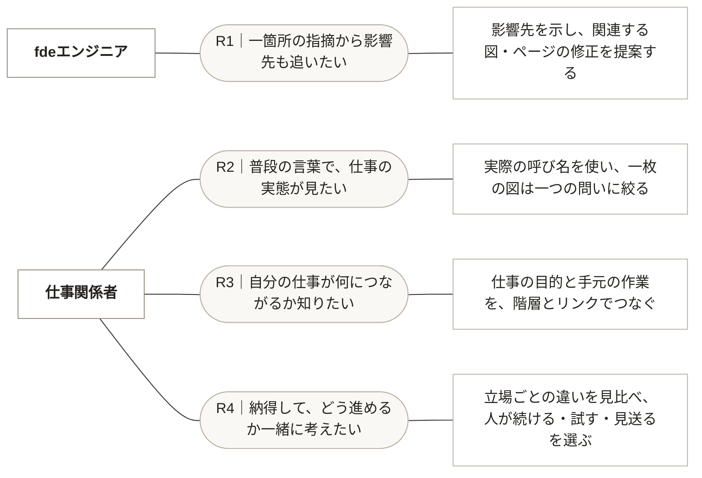
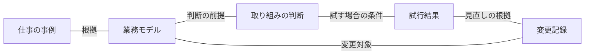

# fde

## テーマコンテキスト図：fdeを育てる

```mermaid
---
config:
  layout: dagre
  theme: neutral
  flowchart:
    curve: basis
    diagramPadding: 24
    htmlLabels: false
    wrappingWidth: 280
    nodeSpacing: 38
    rankSpacing: 58
    padding: 18
  themeVariables:
    background: "#FFFFFF"
    lineColor: "#8A847A"
    fontFamily: "Inter, Hiragino Sans, sans-serif"
    fontSize: "14px"
  themeCSS: ".image-shape p { padding: 0 !important; background-color:#FFFFFF !important; } .image-shape foreignObject { overflow: visible; } .image-shape .labelBkg { background-color:#FFFFFF !important; } .image-shape .label rect { fill:#FFFFFF !important; opacity:1 !important; } .image-shape[id*='-flowchart-b_'] .label p { margin-top: -6px !important; } .image-shape g:first-child path { stroke:#FFFFFF !important; stroke-width:6px !important; }"
---
flowchart LR
  %% テーマコンテキスト図：製品を育てる活動。fdeで描く個々の仕事は別のテーマ。
  %% 右の仕事関係者は一つのアクター群。複数人を表すが、人数や内訳は特定しない。
  %% 点線は目指すゴールを添えるための注釈。業務フローではない。
  a_product_owner@{ label: "fdeエンジニア", img: "https://raw.githubusercontent.com/maakbo/fde/main/assets/icons/maakbo/user.svg", pos: "b", w: 28, h: 28, constraint: "on" }
  a_build_agent@{ label: "fde AI", img: "https://raw.githubusercontent.com/maakbo/fde/main/assets/icons/maakbo/bot.svg", pos: "b", w: 28, h: 28, constraint: "on" }
  b_fde_product("fdeを育てる")
  a_work_members@{ label: "仕事関係者", img: "https://raw.githubusercontent.com/maakbo/fde/523072a59582f5d41d998c1b2f65929afc47270d/experiments/fde-product-pivot/work-group.svg", pos: "b", w: 28, h: 28, constraint: "on" }
  x_github@{ label: "GitHub", img: "https://raw.githubusercontent.com/maakbo/fde/main/assets/icons/maakbo/server.svg", pos: "b", w: 28, h: 28, constraint: "on" }
  goal["仕事をAIと一緒に可視化して、<br/>関わるものたちが納得して進められて、<br/>仕事がうまくいきます。"]

  a_product_owner --- b_fde_product
  a_build_agent --- b_fde_product
  b_fde_product -.- goal
  b_fde_product --- a_work_members
  b_fde_product --- x_github

  classDef icon fill:none,stroke:none,color:#25231F;
  classDef compass fill:none,stroke:none,color:#25231F,font-weight:600;
  classDef themeNode fill:#FFFFFF,stroke:#4A4640,stroke-width:1.25px,color:#25231F,font-weight:700,font-size:23px;
  class a_product_owner,a_build_agent,a_work_members,x_github icon;
  class goal compass;
  class b_fde_product themeNode;
  linkStyle default stroke:#9E988E,stroke-width:0.75px;
  linkStyle 2 stroke:#A0988E,stroke-width:1px,stroke-dasharray:2 4;
```

**ゴール**：仕事をAIと一緒に可視化して、関わるものたちが納得して進められて、仕事がうまくいきます。

ここで扱うテーマは、個別の仕事ではなく、**仕事を一緒に理解し、納得して進めるためのプロダクト「fde」をつくり、使いながら磨くこと**。このページは設計のたたき台です。

## アクターの役割

| アクター | このテーマでの役割 |
| --- | --- |
| fdeエンジニア | fdeの目的と設計を整え、使って分かったことをもとに、何を採用し何を見送るか判断する。自分で試すときは、仕事関係者としての視点も持つ。 |
| fde AI | 会話から仕事の要素・名前・関係を図と言葉にし、指摘が入ったら関連箇所と修正案を示す。採用や仕事の進め方を決めるのは人。 |
| 仕事関係者 | 仕事を進める人、判断や支援を担う人、その仕事の価値を受け取る人。立場ごとの見え方や、図と実際の仕事のズレを持ち寄る。 |
| GitHub | 図のソース、関連ページ、変更履歴を置く外部システム。要求の発言者ではなく、保存・共有・追跡を支える手段。 |

## 要求モデル図



左にアクター、中央にその立場からの要求、右に応え方の案。要求文は会話をもとにした要約で、発言の引用ではない。仕事関係者の要求は、実際に使う人と照らし合わせたい仮説。

### 応え方の判断

| ID | 判断のたたき台 |
| --- | --- |
| R1 | **対応案あり。** 図・ページ・手順のどこに波及するか確認する。似た箇所は提案までとし、一括変更はしない。fde AIが担当し、修正理由をGitHubで追えるようにする。 |
| R2 | **対応案あり。** 用語は関係者が実際に使う言葉から始める。一枚に入りきらない情報は別の図・ページへ。どの粒度なら「そうそう、これ」となるかは未検証。 |
| R3 | **対応案あり。** ルートの目的から仕事・業務・作業へたどれ、手元の作業からも目的に戻れるようにする。階層をまたぐ関係はリンクで残す。 |
| R4 | **対応案あり。** 可視化で止まらず、試す場合は結果を見て判断し、仕事とモデルを更新する。今のやり方に納得して続けることも成果。改善を強制したり、AIが代わりに決めたりはしない。 |

## 業務コンテキスト図

```mermaid
---
config:
  layout: dagre
  theme: neutral
  flowchart:
    curve: basis
    diagramPadding: 24
    htmlLabels: false
    wrappingWidth: 280
    nodeSpacing: 38
    rankSpacing: 58
    padding: 18
  themeVariables:
    background: "#FFFFFF"
    lineColor: "#8A847A"
    fontFamily: "Inter, Hiragino Sans, sans-serif"
    fontSize: "14px"
  themeCSS: ".image-shape p { padding: 0 !important; background-color:#FFFFFF !important; } .image-shape foreignObject { overflow: visible; } .image-shape .labelBkg { background-color:#FFFFFF !important; } .image-shape .label rect { fill:#FFFFFF !important; opacity:1 !important; } .image-shape[id*='-flowchart-b_'] .label p { margin-top: -6px !important; } .image-shape g:first-child path { stroke:#FFFFFF !important; stroke-width:6px !important; }"
---
flowchart LR
  %% 親テーマ: b_fde_product。矢印なしの線は、参加・保管・情報を扱う関係であり、時系列ではない。
  %% 特定の仕事を改善する案件ではなく、fdeが支える業務のまとまり。詳細は親子リンクとIDで追う。
  a_product_owner@{ label: "fdeエンジニア", img: "https://raw.githubusercontent.com/maakbo/fde/main/assets/icons/maakbo/user.svg", pos: "b", w: 28, h: 28, constraint: "on" }
  a_build_agent@{ label: "fde AI", img: "https://raw.githubusercontent.com/maakbo/fde/main/assets/icons/maakbo/bot.svg", pos: "b", w: 28, h: 28, constraint: "on" }
  a_work_members@{ label: "仕事関係者", img: "https://raw.githubusercontent.com/maakbo/fde/523072a59582f5d41d998c1b2f65929afc47270d/experiments/fde-product-pivot/work-group.svg", pos: "b", w: 28, h: 28, constraint: "on" }
  x_github@{ label: "GitHub", img: "https://raw.githubusercontent.com/maakbo/fde/main/assets/icons/maakbo/server.svg", pos: "b", w: 28, h: 28, constraint: "on" }
  b_understand@{ label: "業務を捉える", img: "https://raw.githubusercontent.com/maakbo/fde/main/assets/icons/maakbo/ellipse.svg", pos: "b", w: 28, h: 28, constraint: "on" }
  b_decide@{ label: "取り組みを決める", img: "https://raw.githubusercontent.com/maakbo/fde/main/assets/icons/maakbo/ellipse.svg", pos: "b", w: 28, h: 28, constraint: "on" }
  b_validate@{ label: "改善を試して確かめる", img: "https://raw.githubusercontent.com/maakbo/fde/main/assets/icons/maakbo/ellipse.svg", pos: "b", w: 28, h: 28, constraint: "on" }
  b_maintain@{ label: "仕事とモデルを見直す", img: "https://raw.githubusercontent.com/maakbo/fde/main/assets/icons/maakbo/ellipse.svg", pos: "b", w: 28, h: 28, constraint: "on" }
  i_work_example@{ label: "仕事の事例", img: "https://raw.githubusercontent.com/maakbo/fde/main/assets/icons/maakbo/file.svg", pos: "b", w: 28, h: 28, constraint: "on" }
  i_work_model@{ label: "業務モデル", img: "https://raw.githubusercontent.com/maakbo/fde/main/assets/icons/maakbo/file.svg", pos: "b", w: 28, h: 28, constraint: "on" }
  i_direction@{ label: "取り組みの判断", img: "https://raw.githubusercontent.com/maakbo/fde/main/assets/icons/maakbo/file.svg", pos: "b", w: 28, h: 28, constraint: "on" }
  i_trial@{ label: "試行結果", img: "https://raw.githubusercontent.com/maakbo/fde/main/assets/icons/maakbo/file.svg", pos: "b", w: 28, h: 28, constraint: "on" }
  i_change@{ label: "変更記録", img: "https://raw.githubusercontent.com/maakbo/fde/main/assets/icons/maakbo/file.svg", pos: "b", w: 28, h: 28, constraint: "on" }

  a_work_members --- b_understand
  a_work_members --- b_decide
  a_work_members --- b_validate
  a_work_members --- b_maintain
  a_build_agent --- b_understand
  a_build_agent --- b_decide
  a_build_agent --- b_validate
  a_build_agent --- b_maintain
  a_product_owner --- b_understand
  a_product_owner --- b_decide
  a_product_owner --- b_validate
  a_product_owner --- b_maintain
  i_work_example --- b_understand
  b_understand --- i_work_model
  i_work_model --- b_decide
  b_decide --- i_direction
  i_direction --- b_validate
  b_validate --- i_trial
  i_trial --- b_maintain
  b_maintain --- i_change
  b_maintain --- x_github

  classDef element fill:none,stroke:none,color:#25231F;
  class a_product_owner,a_build_agent,a_work_members,x_github,b_understand,b_decide,b_validate,b_maintain,i_work_example,i_work_model,i_direction,i_trial,i_change element;
  linkStyle default stroke:#9E988E,stroke-width:0.75px;
```

仕事の実態を捉え、何をするかを決め、試すと決めたときは効果を確かめます。現状を続ける場合も、納得した理由を残します。新しい事実やズレが見つかれば、目的や業務モデルに戻って見直します。

| 業務ユースケース | 何を受けて、何を次に渡すか | 対応する要求 |
| --- | --- | --- |
| <a id="uc-understand"></a>[業務を捉える](work/fde-product/understand/README.md) | 仕事の事例を、関係者が一緒に確かめられる業務モデルにする | R2・R3 |
| <a id="uc-decide"></a>[取り組みを決める](work/fde-product/decide/README.md) | 業務モデルをもとに、続ける・試す・見送る理由を残す | R3・R4 |
| <a id="uc-validate"></a>[改善を試して確かめる](work/fde-product/validate/README.md) | 試すと決めた案を動かし、良い変化があったか確かめる | R4 |
| <a id="uc-maintain"></a>[仕事とモデルを見直す](work/fde-product/maintain/README.md) | 試行結果や日々の指摘から、仕事・図・手順への影響を確認し、扱いと理由を残す | R1・R4 |

## 概念データモデル・用語辞書



| 用語 | ここでの意味 |
| --- | --- |
| 仕事の事例 | 実際に起きた一件。誰が何を受け取り、どう判断し、誰に何を渡したかをたどれる話や記録。 |
| 業務モデル | 仕事の目的・関係者・業務・情報のつながりを、利用者の言葉で表したもの。一枚の図や一つのファイルに限らない。 |
| 取り組みの判断 | 今のやり方を続ける、改善を試す、見送るなど、次にどうするかとその理由。試すなら確かめ方も含む。 |
| 試行結果 | 合意した条件のもとで試し、実際にどうなったかを残したもの。分かったことと、まだ測れていないことを分ける。 |
| 変更記録 | 対象・理由・影響先・採否を残したもの。試行結果だけでなく、新しい事例や関係者の指摘を根拠にできる。 |

## 業務の詳しい手順

ルートに置くのは全体の目的・要求・関係・共通語まで。具体的な手順は上の表から業務ごとのREADMEへ進みます。各ページの前半で誰と何を扱うか、後半のスイムレーンで誰がどんな順に動くかを確かめます。用語の意味が変わったら、詳細だけでなくこのページにも戻って直します。

```text
README.md
work/
  fde-product/
    understand/README.md
    decide/README.md
    validate/README.md
    maintain/README.md
```

[FDEの既存業務設計](work/README.md)は、業務理解・対象選定から導入・運用改善までの実務の参照先として残しています。各詳細ページから該当箇所へ進めます。

## fdeを使う

AIエージェントに、このリポジトリを参照させて依頼します。

> 私の業務にAIを取り入れて改善したいです。work/discoveryの手順で、最近の仕事を一緒に整理してください。

担当者が普段使う言葉から始めます。FDEとAIが現状と改善候補を整理して返し、顧客と確かめながら次へ進めます。既に対象や要件が決まっていれば、その業務から始められます。

## 実践例と成果物

- [案件の実践例](examples/README.md)：システム開発へのAI導入を、課題・対話・判断・実装・検証で追う架空例。
- [成果物のフォーマット](templates/README.md)：各業務で使う標準の記録・設計・評価の型。
- [作業単位のSkill](.agents/skills/README.md)：AIエージェントが具体的な作業を進めるための手順。

## 取得と利用

```bash
git clone https://github.com/maakbo/fde.git
cd fde
```

全体を取得する場合はcloneを使います。選択したSkillだけを配布するconsumer profileは、リポジトリ全体と収録範囲が異なります。

実案件の資料と操作は、現場で許可された環境・範囲で扱います。実践例には架空条件・ローカル実行・未測定の区別があります。現場での効果は各案件で確かめます。

[利用・検証の詳細](work/references/repository-usage.md) / [エージェントの作業原則](AGENTS.md) / [License](LICENSE)
