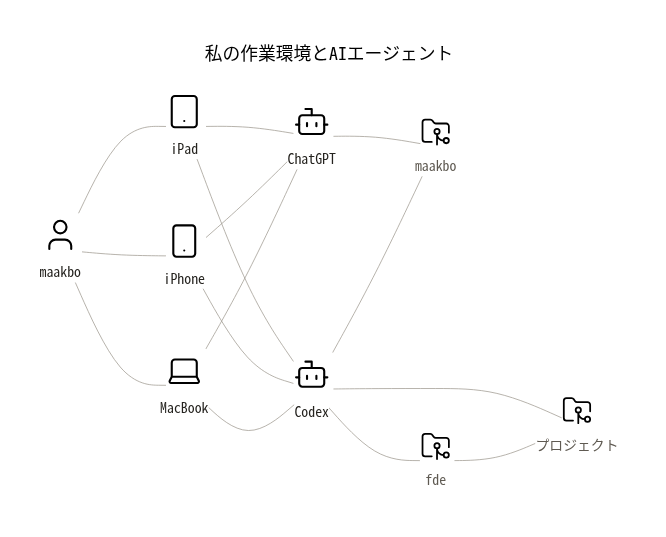

# 作業環境とAIエージェント

maakboの手元の端末、ChatGPT・Codex、GitHubリポジトリのつながりを、1枚のアーキテクチャ図で見るサンプルです。

[作業環境のアーキテクチャを見る](architecture-overview.md)

Mermaidの編集原本はアーキテクチャページ内にあります。PNGとSVGはその原本から生成したプレビューです。

[依頼・レビュー・引き継ぎの別サンプル](handoff-review-flow.md)も参照できます。これは引き継ぎ手順の例で、上の環境図が自動連携を実証した意味ではありません。
