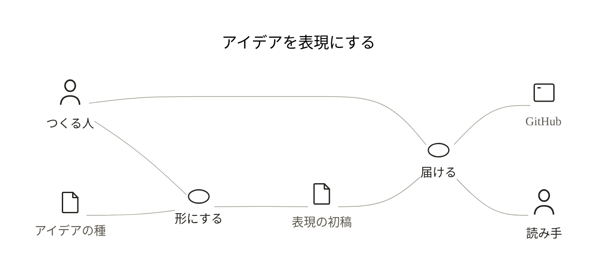
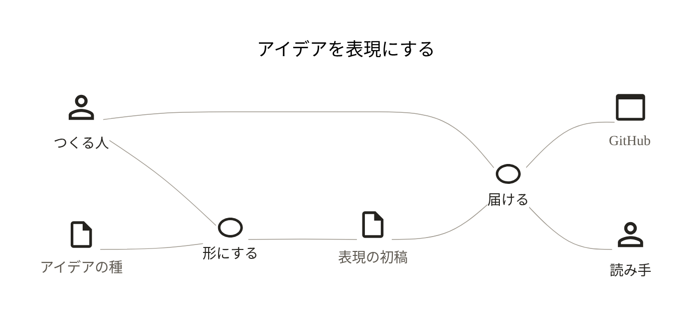

# 図解のアイコンを選ぶ

同じ業務コンテキストを、maakboオリジナルとIconify MDIで描きます。ラベル・関係・ノードの寸法は同じです。

| maakbo | MDI |
| --- | --- |
| [Mermaid原本](maakbo-context.md) | [Mermaid原本](mdi-context.md) |
|  |  |

プロジェクトの `.fde/config.json` で、新しい図に使うセットを選びます。

```json
{
  "icon_set": "mdi"
}
```

`maakbo` へ変えると、新しい図でオリジナルアイコンを使えます。配布先の初期値はMDI、fde自身の設定はmaakboです。スキル更新ではこの設定を上書きしません。

新しい図は `icon_registry.py create` でテンプレートから作ります。既存の図はURLに記録した選択を保ち、設定変更だけでは書き換わりません。移行が必要なときだけ `migrate` を使います。

[設定・新規作成・既存図の移行方法](../../.agents/skills/mermaid-diagram-authoring/references/icon-selection.md)

maakboは[MIT](../../assets/icons/maakbo/LICENSE)、MDIは[Apache-2.0と上流の表示](../../assets/icons/mdi/README.md)に従います。MDIは固定版の図形をそのまま使用しているため、細線のmaakboとは線の重みが異なります。
