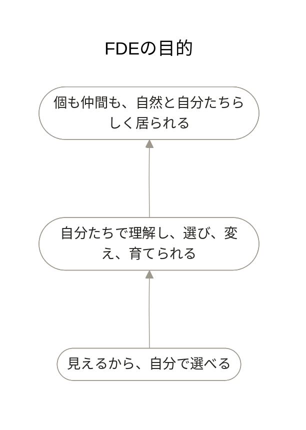

# FDE

## FDEの目的



業務の全体像や、人・情報・システムの関係を共有し、どこを変えるか、その影響は何かを話し合います。使う人たちが自分で判断し、仕組みを変えながら使い続けられることを目指します。

一人ひとりの違いを活かし、自分たちらしく働けることが、その先にある目的です。

## FDEを担う人とAI

```mermaid
---
title: FDEを担う人とAI
config:
  layout: dagre
  theme: neutral
  flowchart:
    curve: basis
    diagramPadding: 40
    htmlLabels: true
    nodeSpacing: 64
    rankSpacing: 80
    padding: 8
  themeVariables:
    background: "#FFFFFF"
    lineColor: "#9E988E"
    fontFamily: "Inter, Hiragino Sans, sans-serif"
    fontSize: "14px"
  themeCSS: ".image-shape p { padding: 0 !important; background-color:#FFFFFF !important; } .image-shape foreignObject { overflow: visible; } .image-shape .labelBkg { background-color:#FFFFFF !important; } .image-shape .label rect { fill:#FFFFFF !important; opacity:1 !important; } .image-shape[id*='-flowchart-b_'] .label p { margin-top: -6px !important; } .image-shape g:first-child path { stroke:#FFFFFF !important; stroke-width:6px !important; }"
---
flowchart LR
  %% 全体に関わる主体を扱う図。個々の業務で使うAIやシステムは、該当する業務の図で扱う。
  a_maakbo_fde@{ label: "fde", img: "https://raw.githubusercontent.com/maakbo/fde/main/assets/icons/maakbo/user.svg", pos: "b", w: 38, h: 38, constraint: "on" }
  a_fde_ai@{ label: "fdeAI", img: "https://raw.githubusercontent.com/maakbo/fde/main/assets/icons/maakbo/user.svg", pos: "b", w: 38, h: 38, constraint: "on" }
  b_fde@{ label: "FDE", img: "https://raw.githubusercontent.com/maakbo/fde/main/assets/icons/maakbo/ellipse.svg", pos: "b", w: 30, h: 30, constraint: "on" }
  a_subject@{ label: "主体者", img: "https://raw.githubusercontent.com/maakbo/fde/main/assets/icons/maakbo/user.svg", pos: "b", w: 38, h: 38, constraint: "on" }
  a_companions@{ label: "主体者の仲間", img: "https://raw.githubusercontent.com/maakbo/fde/main/assets/icons/maakbo/user.svg", pos: "b", w: 38, h: 38, constraint: "on" }
  p_ultimate_purpose(["個も仲間も、自然と自分たちらしく居られる"])

  a_maakbo_fde --- b_fde
  a_fde_ai --- b_fde
  b_fde --- p_ultimate_purpose
  b_fde --- a_subject
  b_fde --- a_companions

  class a_maakbo_fde,a_fde_ai,a_subject,a_companions actor;
  class b_fde business;
  class p_ultimate_purpose purpose;

  classDef actor fill:none,stroke:none,color:#25231F;
  classDef business fill:none,stroke:none,color:#25231F;
  classDef purpose fill:#FFFFFF,stroke:#9E988E,color:#25231F,stroke-width:0.75px;
  linkStyle default stroke:#9E988E,stroke-width:0.75px;
```

主体者と仲間が、現場の実態や困りごと、日々の判断を持ち寄ります。fdeとfdeAIは、それらを言葉や図にまとめます。何を変えるか、どんな仕組みにするかを一緒に考え、使いながら改善します。

## 主体者の判断と改善

```mermaid
---
title: 主体者の判断と改善
config:
  layout: dagre
  theme: neutral
  flowchart:
    curve: basis
    diagramPadding: 40
    htmlLabels: true
    nodeSpacing: 44
    rankSpacing: 84
    padding: 8
  themeVariables:
    background: "#FFFFFF"
    lineColor: "#9E988E"
    fontFamily: "Inter, Hiragino Sans, sans-serif"
    fontSize: "14px"
  themeCSS: ".image-shape p { padding: 0 !important; background-color:#FFFFFF !important; } .image-shape foreignObject { overflow: visible; } .image-shape .labelBkg { background-color:#FFFFFF !important; } .image-shape .label rect { fill:#FFFFFF !important; opacity:1 !important; } .image-shape[id*='-flowchart-b_'] .label p { margin-top: -6px !important; } .image-shape g:first-child path { stroke:#FFFFFF !important; stroke-width:6px !important; }"
---
flowchart LR
  %% 左から主体、必要な状態、そのための支援。線は対応関係であり、処理の順序ではない。
  subgraph actor_lane[" "]
    direction TB
    a_maakbo_fde@{ label: "fde", img: "https://raw.githubusercontent.com/maakbo/fde/main/assets/icons/maakbo/user.svg", pos: "b", w: 38, h: 38, constraint: "on" }
    a_fde_ai@{ label: "fdeAI", img: "https://raw.githubusercontent.com/maakbo/fde/main/assets/icons/maakbo/user.svg", pos: "b", w: 38, h: 38, constraint: "on" }
    a_subject@{ label: "主体者", img: "https://raw.githubusercontent.com/maakbo/fde/main/assets/icons/maakbo/user.svg", pos: "b", w: 38, h: 38, constraint: "on" }
  end
  subgraph requirement_lane[" "]
    direction TB
    r_support(["現場の理解を支える"])
    r_agent_scope(["目的・範囲・必要情報が明確"])
    r_understand(["全体と関係を理解できる"])
    r_consider(["選択肢と影響を考えられる"])
    r_improve(["自分で選び改善できる"])
  end
  subgraph measure_lane[" "]
    direction TB
    m_shape["問いと関係を扱える形にする"]
    m_explicit["役割と制約を明示する"]
    m_visualize["関係を可視化する"]
    m_prepare["判断材料を整える"]
    m_handover["自分で扱える形へ整える"]
  end

  a_maakbo_fde --- r_support
  r_support --- m_shape
  a_fde_ai --- r_agent_scope
  r_agent_scope --- m_explicit
  a_subject --- r_understand
  r_understand --- m_visualize
  a_subject --- r_consider
  r_consider --- m_prepare
  a_subject --- r_improve
  r_improve --- m_handover

  class a_maakbo_fde,a_fde_ai,a_subject actor;
  class r_support,r_agent_scope,r_understand,r_consider,r_improve requirement;
  class m_shape,m_explicit,m_visualize,m_prepare,m_handover measure;

  classDef actor fill:none,stroke:none,color:#25231F;
  classDef requirement fill:#FFFFFF,stroke:#9E988E,color:#25231F,stroke-width:0.75px;
  classDef measure fill:#FFFFFF,stroke:#9E988E,color:#25231F,stroke-width:0.75px;
  style actor_lane fill:none,stroke:none;
  style requirement_lane fill:none,stroke:none;
  style measure_lane fill:none,stroke:none;
  linkStyle default stroke:#9E988E,stroke-width:0.75px;
```

主体者が判断するには、業務の全体像を理解し、選択肢とその影響を比べられる必要があります。業務の関係を見える形にし、判断に必要な情報をそろえます。

fdeとfdeAIが支援する範囲や制約も明らかにします。判断の根拠や変更の方法を共有し、主体者が自分で選び、改善できるようにします。

## FDEの業務

```mermaid
---
title: FDEの業務
config:
  layout: dagre
  theme: neutral
  flowchart:
    curve: basis
    diagramPadding: 40
    htmlLabels: false
    nodeSpacing: 64
    rankSpacing: 80
    padding: 8
  themeVariables:
    background: "#FFFFFF"
    lineColor: "#9E988E"
    fontFamily: "Inter, Hiragino Sans, sans-serif"
    fontSize: "14px"
  themeCSS: ".image-shape p { padding: 0 !important; background-color:#FFFFFF !important; } .image-shape foreignObject { overflow: visible; } .image-shape .labelBkg { background-color:#FFFFFF !important; } .image-shape .label rect { fill:#FFFFFF !important; opacity:1 !important; } .image-shape[id*='-flowchart-b_'] .label p { margin-top: -6px !important; } .image-shape g:first-child path { stroke:#FFFFFF !important; stroke-width:6px !important; }"
---
flowchart TB
  %% 七つの業務の分類。工程の順序は delivery-process.md の図で扱う。
  b_fde@{ label: "FDE", img: "https://raw.githubusercontent.com/maakbo/fde/main/assets/icons/maakbo/ellipse.svg", pos: "b", w: 30, h: 30, constraint: "on" }
  b_context_understanding@{ label: "現場理解", img: "https://raw.githubusercontent.com/maakbo/fde/main/assets/icons/maakbo/ellipse.svg", pos: "b", w: 30, h: 30, constraint: "on" }
  b_business_structuring@{ label: "業務構造化", img: "https://raw.githubusercontent.com/maakbo/fde/main/assets/icons/maakbo/ellipse.svg", pos: "b", w: 30, h: 30, constraint: "on" }
  b_change_design@{ label: "変化設計", img: "https://raw.githubusercontent.com/maakbo/fde/main/assets/icons/maakbo/ellipse.svg", pos: "b", w: 30, h: 30, constraint: "on" }
  b_collaboration_design@{ label: "協働設計", img: "https://raw.githubusercontent.com/maakbo/fde/main/assets/icons/maakbo/ellipse.svg", pos: "b", w: 30, h: 30, constraint: "on" }
  b_realization@{ label: "仕組み化", img: "https://raw.githubusercontent.com/maakbo/fde/main/assets/icons/maakbo/ellipse.svg", pos: "b", w: 30, h: 30, constraint: "on" }
  b_context_fit@{ label: "現場適合", img: "https://raw.githubusercontent.com/maakbo/fde/main/assets/icons/maakbo/ellipse.svg", pos: "b", w: 30, h: 30, constraint: "on" }
  b_autonomy_transition@{ label: "自律移行", img: "https://raw.githubusercontent.com/maakbo/fde/main/assets/icons/maakbo/ellipse.svg", pos: "b", w: 30, h: 30, constraint: "on" }

  b_fde --- b_context_understanding
  b_fde --- b_business_structuring
  b_fde --- b_change_design
  b_fde --- b_collaboration_design
  b_fde --- b_realization
  b_fde --- b_context_fit
  b_fde --- b_autonomy_transition

  class b_fde,b_context_understanding,b_business_structuring,b_change_design,b_collaboration_design,b_realization,b_context_fit,b_autonomy_transition business;
  classDef business fill:none,stroke:none,color:#25231F;
  linkStyle default stroke:#9E988E,stroke-width:0.75px;
```

七つの業務を、状況に応じて行き来します。検証や利用で分かったことをもとに、業務の理解や設計を見直します。

対象選定から導入・改善までの流れは、[FDEの進め方](delivery-process.md)に沿って具体化します。

## 業務の変化を描く

```mermaid
---
title: 業務の変化を描く
config:
  layout: dagre
  theme: neutral
  flowchart:
    curve: basis
    diagramPadding: 40
    htmlLabels: false
    nodeSpacing: 64
    rankSpacing: 80
    padding: 8
  themeVariables:
    background: "#FFFFFF"
    lineColor: "#9E988E"
    fontFamily: "Inter, Hiragino Sans, sans-serif"
    fontSize: "14px"
  themeCSS: ".image-shape p { padding: 0 !important; background-color:#FFFFFF !important; } .image-shape foreignObject { overflow: visible; } .image-shape .labelBkg { background-color:#FFFFFF !important; } .image-shape .label rect { fill:#FFFFFF !important; opacity:1 !important; } .image-shape[id*='-flowchart-b_'] .label p { margin-top: -6px !important; } .image-shape g:first-child path { stroke:#FFFFFF !important; stroke-width:6px !important; }"
---
flowchart LR
  %% 親図: FDEの業務。b_context_understanding、b_business_structuring、b_change_design の詳細。
  %% 線の記述順はDagreの配置に影響する。関係の編集後は全体をプレビューする。
  %% 関連線は参加や情報の関係。業務の順序は「対象を見極め、業務を定義する」の図で扱う。
  a_fde@{ label: "fde", img: "https://raw.githubusercontent.com/maakbo/fde/main/assets/icons/maakbo/user.svg", pos: "b", w: 38, h: 38, constraint: "on" }
  a_fde_ai@{ label: "fdeAI", img: "https://raw.githubusercontent.com/maakbo/fde/main/assets/icons/maakbo/user.svg", pos: "b", w: 38, h: 38, constraint: "on" }
  i_context_information@{ label: "業務の現状", img: "https://raw.githubusercontent.com/maakbo/fde/main/assets/icons/maakbo/file.svg", pos: "b", w: 32, h: 32, constraint: "on" }
  i_business_issue@{ label: "業務課題", img: "https://raw.githubusercontent.com/maakbo/fde/main/assets/icons/maakbo/file.svg", pos: "b", w: 32, h: 32, constraint: "on" }
  i_desired_state@{ label: "ありたい状態", img: "https://raw.githubusercontent.com/maakbo/fde/main/assets/icons/maakbo/file.svg", pos: "b", w: 32, h: 32, constraint: "on" }
  b_context_understanding@{ label: "現場理解", img: "https://raw.githubusercontent.com/maakbo/fde/main/assets/icons/maakbo/ellipse.svg", pos: "b", w: 30, h: 30, constraint: "on" }
  b_business_structuring@{ label: "業務構造化", img: "https://raw.githubusercontent.com/maakbo/fde/main/assets/icons/maakbo/ellipse.svg", pos: "b", w: 30, h: 30, constraint: "on" }
  i_business_model@{ label: "業務モデル", img: "https://raw.githubusercontent.com/maakbo/fde/main/assets/icons/maakbo/file.svg", pos: "b", w: 32, h: 32, constraint: "on" }
  b_change_design@{ label: "変化設計", img: "https://raw.githubusercontent.com/maakbo/fde/main/assets/icons/maakbo/ellipse.svg", pos: "b", w: 30, h: 30, constraint: "on" }
  i_target_priority@{ label: "対象と優先順位", img: "https://raw.githubusercontent.com/maakbo/fde/main/assets/icons/maakbo/file.svg", pos: "b", w: 32, h: 32, constraint: "on" }
  i_requirement_basis@{ label: "要件の叩き台", img: "https://raw.githubusercontent.com/maakbo/fde/main/assets/icons/maakbo/file.svg", pos: "b", w: 32, h: 32, constraint: "on" }
  a_subject@{ label: "主体者", img: "https://raw.githubusercontent.com/maakbo/fde/main/assets/icons/maakbo/user.svg", pos: "b", w: 38, h: 38, constraint: "on" }
  a_companions@{ label: "主体者の仲間", img: "https://raw.githubusercontent.com/maakbo/fde/main/assets/icons/maakbo/user.svg", pos: "b", w: 38, h: 38, constraint: "on" }

  a_fde --- b_context_understanding
  a_fde --- b_business_structuring
  a_fde --- b_change_design
  a_fde_ai --- b_context_understanding
  a_fde_ai --- b_business_structuring
  a_fde_ai --- b_change_design
  i_context_information --- b_context_understanding
  i_context_information --- b_business_structuring
  i_business_issue --- b_context_understanding
  i_business_issue --- b_change_design
  i_desired_state --- b_change_design
  b_context_understanding --- i_business_model
  b_business_structuring --- i_business_model
  i_business_model --- b_change_design
  b_change_design --- i_target_priority
  b_change_design --- i_requirement_basis
  b_context_understanding --- a_subject
  b_business_structuring --- a_subject
  b_change_design --- a_subject
  b_context_understanding --- a_companions
  b_business_structuring --- a_companions
  b_change_design --- a_companions

  class a_fde,a_fde_ai,a_subject,a_companions actor;
  class b_context_understanding,b_business_structuring,b_change_design business;
  class i_context_information,i_business_issue,i_desired_state,i_business_model,i_target_priority,i_requirement_basis information;

  classDef actor fill:none,stroke:none,color:#25231F;
  classDef business fill:none,stroke:none,color:#25231F;
  classDef information fill:none,stroke:none,color:#5F5A52;
  linkStyle default stroke:#9E988E,stroke-width:0.75px;
```

主体者と仲間が、現場の実態や困りごと、経験から得た判断を持ち寄ります。fdeとfdeAIが業務の流れや関係をまとめ、関わる人たちで確かめます。判断基準、例外、前提、制約も共有します。

そのうえで、減らせる仕事と、改善が必要な箇所を見つけます。ありたい状態と現状を比べ、効果、実現可能性、リスクから対象と優先順位を決めます。設計に進めるよう、対象範囲、要件、合格基準をまとめます。

## 対象を見極め、業務を定義する

```mermaid
---
title: 対象を見極め、業務を定義する
config:
  layout: dagre
  theme: neutral
  flowchart:
    curve: basis
    diagramPadding: 40
    htmlLabels: false
    nodeSpacing: 52
    rankSpacing: 52
    padding: 8
  themeVariables:
    background: "#FFFFFF"
    lineColor: "#9E988E"
    primaryTextColor: "#25231F"
    edgeLabelBackground: "#FFFFFF"
    fontFamily: "Inter, Hiragino Sans, sans-serif"
    fontSize: "14px"
  themeCSS: ".image-shape p { padding: 0 !important; background-color:#FFFFFF !important; } .image-shape foreignObject { overflow: visible; } .image-shape .labelBkg { background-color:#FFFFFF !important; } .image-shape .label rect { fill:#FFFFFF !important; opacity:1 !important; } .image-shape[id*='-flowchart-b_'] .label p { margin-top: -6px !important; } .image-shape g:first-child path { stroke:#FFFFFF !important; stroke-width:6px !important; }"
---
flowchart TB
  %% 親図: 業務の変化を描く。対象選定と要件の具体化までの作業順序。
  b_overview@{ label: "業務を見渡す", img: "https://raw.githubusercontent.com/maakbo/fde/main/assets/icons/maakbo/ellipse.svg", pos: "b", w: 30, h: 30, constraint: "on" }
  b_simplify@{ label: "不要を減らす", img: "https://raw.githubusercontent.com/maakbo/fde/main/assets/icons/maakbo/ellipse.svg", pos: "b", w: 30, h: 30, constraint: "on" }
  b_bottleneck@{ label: "ボトルネックを絞る", img: "https://raw.githubusercontent.com/maakbo/fde/main/assets/icons/maakbo/ellipse.svg", pos: "b", w: 30, h: 30, constraint: "on" }
  b_choose_means@{ label: "手段を見極める", img: "https://raw.githubusercontent.com/maakbo/fde/main/assets/icons/maakbo/ellipse.svg", pos: "b", w: 30, h: 30, constraint: "on" }
  b_prioritize@{ label: "対象を選ぶ", img: "https://raw.githubusercontent.com/maakbo/fde/main/assets/icons/maakbo/ellipse.svg", pos: "b", w: 30, h: 30, constraint: "on" }
  b_scope@{ label: "境界を定める", img: "https://raw.githubusercontent.com/maakbo/fde/main/assets/icons/maakbo/ellipse.svg", pos: "b", w: 30, h: 30, constraint: "on" }
  b_requirements@{ label: "要件を言葉にする", img: "https://raw.githubusercontent.com/maakbo/fde/main/assets/icons/maakbo/ellipse.svg", pos: "b", w: 30, h: 30, constraint: "on" }

  b_overview --> b_simplify
  b_simplify --> b_bottleneck
  b_bottleneck --> b_choose_means
  b_choose_means --> b_prioritize
  b_prioritize --> b_scope
  b_scope --> b_requirements

  class b_overview,b_simplify,b_bottleneck,b_choose_means,b_prioritize,b_scope,b_requirements activity;
  classDef activity fill:none,stroke:none,color:#25231F;
  linkStyle default stroke:#9E988E,stroke-width:0.75px,fill:none;
```

業務の流れに加え、判断、例外、待ち、手戻り、ミス、特定の人に頼っている仕事、使っている情報を確認します。なくせる作業、まとめられる作業、順番を変えられる作業、単純にできる作業を先に整理します。

残った課題のうち、生産性や価値への影響が大きい箇所を絞ります。人が担うか、ルールやRPAで処理するか、AIを使うかを比較し、効果、実現可能性、リスクを踏まえて対象を選びます。

対象と対象外、前提、制約、合格基準を関係者で確認します。必要な機能に加え、速度、可用性、品質などの条件も、実装担当者と具体化できる形にまとめます。

## 協働の仕組みをつくる

```mermaid
---
title: 協働の仕組みをつくる
config:
  layout: dagre
  theme: neutral
  flowchart:
    curve: basis
    diagramPadding: 40
    htmlLabels: false
    nodeSpacing: 64
    rankSpacing: 80
    padding: 8
  themeVariables:
    background: "#FFFFFF"
    lineColor: "#9E988E"
    fontFamily: "Inter, Hiragino Sans, sans-serif"
    fontSize: "14px"
  themeCSS: ".image-shape p { padding: 0 !important; background-color:#FFFFFF !important; } .image-shape foreignObject { overflow: visible; } .image-shape .labelBkg { background-color:#FFFFFF !important; } .image-shape .label rect { fill:#FFFFFF !important; opacity:1 !important; } .image-shape[id*='-flowchart-b_'] .label p { margin-top: -6px !important; } .image-shape g:first-child path { stroke:#FFFFFF !important; stroke-width:6px !important; }"
---
flowchart LR
  %% 親図: FDEの業務。b_collaboration_design、b_realization、b_context_fit の詳細。
  %% 線の記述順はDagreの配置に影響する。関係の編集後は全体をプレビューする。
  %% 関連線は参加や情報の関係。設計・検証の順序は「協働を設計し、小さく確かめる」の図で扱う。
  a_fde@{ label: "fde", img: "https://raw.githubusercontent.com/maakbo/fde/main/assets/icons/maakbo/user.svg", pos: "b", w: 38, h: 38, constraint: "on" }
  a_fde_ai@{ label: "fdeAI", img: "https://raw.githubusercontent.com/maakbo/fde/main/assets/icons/maakbo/user.svg", pos: "b", w: 38, h: 38, constraint: "on" }
  i_business_model@{ label: "業務モデル", img: "https://raw.githubusercontent.com/maakbo/fde/main/assets/icons/maakbo/file.svg", pos: "b", w: 32, h: 32, constraint: "on" }
  i_target_priority@{ label: "対象と優先順位", img: "https://raw.githubusercontent.com/maakbo/fde/main/assets/icons/maakbo/file.svg", pos: "b", w: 32, h: 32, constraint: "on" }
  i_requirement_basis@{ label: "要件の叩き台", img: "https://raw.githubusercontent.com/maakbo/fde/main/assets/icons/maakbo/file.svg", pos: "b", w: 32, h: 32, constraint: "on" }
  b_collaboration_design@{ label: "協働設計", img: "https://raw.githubusercontent.com/maakbo/fde/main/assets/icons/maakbo/ellipse.svg", pos: "b", w: 30, h: 30, constraint: "on" }
  i_roles_constraints@{ label: "役割と責任", img: "https://raw.githubusercontent.com/maakbo/fde/main/assets/icons/maakbo/file.svg", pos: "b", w: 32, h: 32, constraint: "on" }
  i_solution_design@{ label: "仕組みの設計", img: "https://raw.githubusercontent.com/maakbo/fde/main/assets/icons/maakbo/file.svg", pos: "b", w: 32, h: 32, constraint: "on" }
  b_realization@{ label: "仕組み化", img: "https://raw.githubusercontent.com/maakbo/fde/main/assets/icons/maakbo/ellipse.svg", pos: "b", w: 30, h: 30, constraint: "on" }
  i_prototype@{ label: "試せる仕組み", img: "https://raw.githubusercontent.com/maakbo/fde/main/assets/icons/maakbo/file.svg", pos: "b", w: 32, h: 32, constraint: "on" }
  b_context_fit@{ label: "現場適合", img: "https://raw.githubusercontent.com/maakbo/fde/main/assets/icons/maakbo/ellipse.svg", pos: "b", w: 30, h: 30, constraint: "on" }
  i_poc_result@{ label: "検証結果", img: "https://raw.githubusercontent.com/maakbo/fde/main/assets/icons/maakbo/file.svg", pos: "b", w: 32, h: 32, constraint: "on" }
  a_subject@{ label: "主体者", img: "https://raw.githubusercontent.com/maakbo/fde/main/assets/icons/maakbo/user.svg", pos: "b", w: 38, h: 38, constraint: "on" }
  a_companions@{ label: "主体者の仲間", img: "https://raw.githubusercontent.com/maakbo/fde/main/assets/icons/maakbo/user.svg", pos: "b", w: 38, h: 38, constraint: "on" }

  i_business_model --- b_collaboration_design
  i_target_priority --- b_collaboration_design
  i_requirement_basis --- b_collaboration_design
  b_collaboration_design --- i_roles_constraints
  b_collaboration_design --- i_solution_design
  i_roles_constraints --- b_realization
  i_solution_design --- b_realization
  b_realization --- i_prototype
  i_prototype --- b_context_fit
  b_context_fit --- i_poc_result
  a_fde_ai --- b_context_fit
  a_fde_ai --- b_realization
  a_fde_ai --- b_collaboration_design
  a_fde --- b_context_fit
  a_fde --- b_realization
  a_fde --- b_collaboration_design
  b_collaboration_design --- a_subject
  b_realization --- a_subject
  b_context_fit --- a_subject
  b_collaboration_design --- a_companions
  b_context_fit --- a_companions

  class a_fde,a_fde_ai,a_subject,a_companions actor;
  class b_collaboration_design,b_realization,b_context_fit business;
  class i_business_model,i_target_priority,i_requirement_basis,i_roles_constraints,i_solution_design,i_prototype,i_poc_result information;

  classDef actor fill:none,stroke:none,color:#25231F;
  classDef business fill:none,stroke:none,color:#25231F;
  classDef information fill:none,stroke:none,color:#5F5A52;
  linkStyle default stroke:#9E988E,stroke-width:0.75px;
```

主体者と仲間、fde、fdeAIが、対象業務と要件をもとに役割を分担します。人が判断すること、AIに任せる処理、ルールやRPAで処理すること、既存システムが担うことを決めます。

AIに渡す目的、前提、制約、参照情報をそろえ、入出力や権限、人が確認する箇所を設計します。まず試せる小さな仕組みをつくり、安全な環境で業務に使えるかを確かめます。

## 協働を設計し、小さく確かめる

```mermaid
---
title: 協働を設計し、小さく確かめる
config:
  layout: dagre
  theme: neutral
  flowchart:
    curve: basis
    diagramPadding: 40
    htmlLabels: false
    nodeSpacing: 52
    rankSpacing: 52
    padding: 8
  themeVariables:
    background: "#FFFFFF"
    lineColor: "#9E988E"
    primaryTextColor: "#25231F"
    edgeLabelBackground: "#FFFFFF"
    fontFamily: "Inter, Hiragino Sans, sans-serif"
    fontSize: "14px"
  themeCSS: ".image-shape p { padding: 0 !important; background-color:#FFFFFF !important; } .image-shape foreignObject { overflow: visible; } .image-shape .labelBkg { background-color:#FFFFFF !important; } .image-shape .label rect { fill:#FFFFFF !important; opacity:1 !important; } .image-shape[id*='-flowchart-b_'] .label p { margin-top: -6px !important; } .image-shape g:first-child path { stroke:#FFFFFF !important; stroke-width:6px !important; }"
---
flowchart TB
  %% 親図: 協働の仕組みをつくる。設計から検証、導入可否の判断までの作業順序。
  %% 導入中止や手段変更の判断は本文に残す。分岐を増やす場合は、この判断との対応を確認する。
  b_split_roles@{ label: "役割を分ける", img: "https://raw.githubusercontent.com/maakbo/fde/main/assets/icons/maakbo/ellipse.svg", pos: "b", w: 30, h: 30, constraint: "on" }
  b_design_context@{ label: "文脈を設計する", img: "https://raw.githubusercontent.com/maakbo/fde/main/assets/icons/maakbo/ellipse.svg", pos: "b", w: 30, h: 30, constraint: "on" }
  b_design_io@{ label: "入出力と安全を決める", img: "https://raw.githubusercontent.com/maakbo/fde/main/assets/icons/maakbo/ellipse.svg", pos: "b", w: 30, h: 30, constraint: "on" }
  b_prototype@{ label: "試せる形にする", img: "https://raw.githubusercontent.com/maakbo/fde/main/assets/icons/maakbo/ellipse.svg", pos: "b", w: 30, h: 30, constraint: "on" }
  b_verify@{ label: "成立性を確かめる", img: "https://raw.githubusercontent.com/maakbo/fde/main/assets/icons/maakbo/ellipse.svg", pos: "b", w: 30, h: 30, constraint: "on" }
  d_ready@{ label: "本番へ進める?", img: "https://raw.githubusercontent.com/maakbo/fde/main/assets/icons/maakbo/diamond.svg", pos: "b", w: 38, h: 38, constraint: "on" }
  b_prepare@{ label: "導入を準備する", img: "https://raw.githubusercontent.com/maakbo/fde/main/assets/icons/maakbo/ellipse.svg", pos: "b", w: 30, h: 30, constraint: "on" }
  b_rework@{ label: "設計を見直す", img: "https://raw.githubusercontent.com/maakbo/fde/main/assets/icons/maakbo/ellipse.svg", pos: "b", w: 30, h: 30, constraint: "on" }

  b_split_roles --> b_design_context
  b_design_context --> b_design_io
  b_design_io --> b_prototype
  b_prototype --> b_verify
  b_verify --> d_ready
  d_ready -->|進める| b_prepare
  d_ready -->|見直す| b_rework
  b_rework --> b_design_context

  class b_split_roles,b_design_context,b_design_io,b_prototype,b_verify,b_prepare,b_rework activity;
  class d_ready decision;
  classDef activity fill:none,stroke:none,color:#25231F;
  classDef decision fill:none,stroke:none,color:#25231F;
  linkStyle default stroke:#9E988E,stroke-width:0.75px,fill:none;
```

人とAIの責任を分け、AIに渡す目的、前提、制約、参照情報、判断例をそろえます。入力データと出力形式を決め、JSONなどの構造や内容をどう検証するかも具体化します。

利用できる情報と権限、人が確認・承認・介入する箇所、禁止する操作を決めます。セキュリティや法務に関わる事項は、実装担当者と必要な専門家で確認します。

試作品を安全な環境で動かし、精度、速度、安全性、再現性、コスト、現場での使いやすさを確かめます。合格基準を満たすかどうかをもとに、導入に進むか、設計や方法を見直すか、導入をやめるかを判断します。

## 仕組みを現場へ根づかせる

```mermaid
---
title: 仕組みを現場へ根づかせる
config:
  layout: dagre
  theme: neutral
  flowchart:
    curve: basis
    diagramPadding: 40
    htmlLabels: false
    nodeSpacing: 64
    rankSpacing: 80
    padding: 8
  themeVariables:
    background: "#FFFFFF"
    lineColor: "#9E988E"
    fontFamily: "Inter, Hiragino Sans, sans-serif"
    fontSize: "14px"
  themeCSS: ".image-shape p { padding: 0 !important; background-color:#FFFFFF !important; } .image-shape foreignObject { overflow: visible; } .image-shape .labelBkg { background-color:#FFFFFF !important; } .image-shape .label rect { fill:#FFFFFF !important; opacity:1 !important; } .image-shape[id*='-flowchart-b_'] .label p { margin-top: -6px !important; } .image-shape g:first-child path { stroke:#FFFFFF !important; stroke-width:6px !important; }"
---
flowchart LR
  %% 親図: FDEの業務。b_context_fit、b_autonomy_transition の詳細。
  %% 線の記述順はDagreの配置に影響する。関係の編集後は全体をプレビューする。
  %% 関連線は参加や情報の関係。導入・改善・展開の順序は「現場で使い、学びながら広げる」の図で扱う。
  a_fde@{ label: "fde", img: "https://raw.githubusercontent.com/maakbo/fde/main/assets/icons/maakbo/user.svg", pos: "b", w: 38, h: 38, constraint: "on" }
  a_fde_ai@{ label: "fdeAI", img: "https://raw.githubusercontent.com/maakbo/fde/main/assets/icons/maakbo/user.svg", pos: "b", w: 38, h: 38, constraint: "on" }
  i_poc_result@{ label: "検証結果", img: "https://raw.githubusercontent.com/maakbo/fde/main/assets/icons/maakbo/file.svg", pos: "b", w: 32, h: 32, constraint: "on" }
  i_roles_constraints@{ label: "役割と責任", img: "https://raw.githubusercontent.com/maakbo/fde/main/assets/icons/maakbo/file.svg", pos: "b", w: 32, h: 32, constraint: "on" }
  i_usage_result@{ label: "利用結果", img: "https://raw.githubusercontent.com/maakbo/fde/main/assets/icons/maakbo/file.svg", pos: "b", w: 32, h: 32, constraint: "on" }
  i_outcome@{ label: "業務の成果", img: "https://raw.githubusercontent.com/maakbo/fde/main/assets/icons/maakbo/file.svg", pos: "b", w: 32, h: 32, constraint: "on" }
  i_feedback@{ label: "現場の知見", img: "https://raw.githubusercontent.com/maakbo/fde/main/assets/icons/maakbo/file.svg", pos: "b", w: 32, h: 32, constraint: "on" }
  b_context_fit@{ label: "現場適合", img: "https://raw.githubusercontent.com/maakbo/fde/main/assets/icons/maakbo/ellipse.svg", pos: "b", w: 30, h: 30, constraint: "on" }
  i_business_model@{ label: "業務モデル", img: "https://raw.githubusercontent.com/maakbo/fde/main/assets/icons/maakbo/file.svg", pos: "b", w: 32, h: 32, constraint: "on" }
  i_work_system@{ label: "業務の仕組み", img: "https://raw.githubusercontent.com/maakbo/fde/main/assets/icons/maakbo/file.svg", pos: "b", w: 32, h: 32, constraint: "on" }
  i_knowledge@{ label: "共有知識", img: "https://raw.githubusercontent.com/maakbo/fde/main/assets/icons/maakbo/file.svg", pos: "b", w: 32, h: 32, constraint: "on" }
  b_autonomy_transition@{ label: "自律移行", img: "https://raw.githubusercontent.com/maakbo/fde/main/assets/icons/maakbo/ellipse.svg", pos: "b", w: 30, h: 30, constraint: "on" }
  a_subject@{ label: "主体者", img: "https://raw.githubusercontent.com/maakbo/fde/main/assets/icons/maakbo/user.svg", pos: "b", w: 38, h: 38, constraint: "on" }
  a_companions@{ label: "主体者の仲間", img: "https://raw.githubusercontent.com/maakbo/fde/main/assets/icons/maakbo/user.svg", pos: "b", w: 38, h: 38, constraint: "on" }

  a_fde_ai --- b_autonomy_transition
  a_fde_ai --- b_context_fit
  a_fde --- b_autonomy_transition
  a_fde --- b_context_fit
  i_knowledge --- b_autonomy_transition
  i_work_system --- b_autonomy_transition
  i_business_model --- b_autonomy_transition
  b_context_fit --- i_knowledge
  b_context_fit --- i_work_system
  b_context_fit --- i_business_model
  i_feedback --- b_context_fit
  i_outcome --- b_context_fit
  i_usage_result --- b_context_fit
  i_roles_constraints --- b_autonomy_transition
  i_roles_constraints --- b_context_fit
  i_poc_result --- b_context_fit
  b_context_fit --- a_subject
  b_autonomy_transition --- a_subject
  b_context_fit --- a_companions
  b_autonomy_transition --- a_companions

  class a_fde,a_fde_ai,a_subject,a_companions actor;
  class b_context_fit,b_autonomy_transition business;
  class i_poc_result,i_roles_constraints,i_usage_result,i_outcome,i_feedback,i_business_model,i_work_system,i_knowledge information;

  classDef actor fill:none,stroke:none,color:#25231F;
  classDef business fill:none,stroke:none,color:#25231F;
  classDef information fill:none,stroke:none,color:#5F5A52;
  linkStyle default stroke:#9E988E,stroke-width:0.75px;
```

検証を通った仕組みを、主体者と仲間が限られた範囲で使い始めます。fdeとfdeAIも利用結果を確認し、業務や人に起きた変化を一緒に確かめます。

担当者が使う中で得た感覚や判断を言葉にし、業務モデル、プロンプト、ルール、共有知識を更新します。改善した仕組みを使うことで、担当者の判断にも新しい知見が加わります。

運営、判断、変更の責任を主体者と仲間へ移し、自分たちで改善を続けられるようにします。

## 現場で使い、学びながら広げる

```mermaid
---
title: 現場で使い、学びながら広げる
config:
  layout: dagre
  theme: neutral
  flowchart:
    curve: basis
    diagramPadding: 40
    htmlLabels: false
    nodeSpacing: 52
    rankSpacing: 52
    padding: 8
  themeVariables:
    background: "#FFFFFF"
    lineColor: "#9E988E"
    primaryTextColor: "#25231F"
    edgeLabelBackground: "#FFFFFF"
    fontFamily: "Inter, Hiragino Sans, sans-serif"
    fontSize: "14px"
  themeCSS: ".image-shape p { padding: 0 !important; background-color:#FFFFFF !important; } .image-shape foreignObject { overflow: visible; } .image-shape .labelBkg { background-color:#FFFFFF !important; } .image-shape .label rect { fill:#FFFFFF !important; opacity:1 !important; } .image-shape[id*='-flowchart-b_'] .label p { margin-top: -6px !important; } .image-shape g:first-child path { stroke:#FFFFFF !important; stroke-width:6px !important; }"
---
flowchart TB
  %% 親図: 仕組みを現場へ根づかせる。同じ仕組みの利用範囲を広げる判断を扱う。
  %% 新機能、処理能力、別業務への拡張は、この図の「利用を広げる」と分けて扱う。
  b_limited_rollout@{ label: "限定導入する", img: "https://raw.githubusercontent.com/maakbo/fde/main/assets/icons/maakbo/ellipse.svg", pos: "b", w: 30, h: 30, constraint: "on" }
  b_observe_use@{ label: "利用を観測する", img: "https://raw.githubusercontent.com/maakbo/fde/main/assets/icons/maakbo/ellipse.svg", pos: "b", w: 30, h: 30, constraint: "on" }
  b_measure_outcome@{ label: "成果を測る", img: "https://raw.githubusercontent.com/maakbo/fde/main/assets/icons/maakbo/ellipse.svg", pos: "b", w: 30, h: 30, constraint: "on" }
  b_update_knowledge@{ label: "知識を更新する", img: "https://raw.githubusercontent.com/maakbo/fde/main/assets/icons/maakbo/ellipse.svg", pos: "b", w: 30, h: 30, constraint: "on" }
  b_improve@{ label: "仕組みを改善する", img: "https://raw.githubusercontent.com/maakbo/fde/main/assets/icons/maakbo/ellipse.svg", pos: "b", w: 30, h: 30, constraint: "on" }
  d_expand@{ label: "利用を広げる?", img: "https://raw.githubusercontent.com/maakbo/fde/main/assets/icons/maakbo/diamond.svg", pos: "b", w: 38, h: 38, constraint: "on" }
  b_rollout@{ label: "利用を広げる", img: "https://raw.githubusercontent.com/maakbo/fde/main/assets/icons/maakbo/ellipse.svg", pos: "b", w: 30, h: 30, constraint: "on" }
  b_continue@{ label: "限定で続ける", img: "https://raw.githubusercontent.com/maakbo/fde/main/assets/icons/maakbo/ellipse.svg", pos: "b", w: 30, h: 30, constraint: "on" }

  b_limited_rollout --> b_observe_use
  b_observe_use --> b_measure_outcome
  b_measure_outcome --> b_update_knowledge
  b_update_knowledge --> b_improve
  b_improve --> d_expand
  d_expand -->|広げる| b_rollout
  d_expand -->|続ける| b_continue
  b_continue --> b_observe_use

  class b_limited_rollout,b_observe_use,b_measure_outcome,b_update_knowledge,b_improve,b_rollout,b_continue activity;
  class d_expand decision;
  classDef activity fill:none,stroke:none,color:#25231F;
  classDef decision fill:none,stroke:none,color:#25231F;
  linkStyle default stroke:#9E988E,stroke-width:0.75px,fill:none;
```

限られた利用者や範囲で使い、現場の仕事とのずれを確かめます。利用件数に加え、処理時間、手戻り、担当者間の判断の一致、顧客や利用者に届いた価値を確認します。短期間で分かる変化と、時間をかけて追う成果は分けて評価します。

現場で得た判断や知見を、プロンプト、ルール、業務モデル、ナレッジベースに反映し、仕組みを改善します。改善後も利用と評価を続け、同じ仕組みを使う人や範囲を段階的に広げます。

処理能力を高める、新しい機能を加える、別の業務に適用するといった変更は、利用者を増やすこととは分けて検討します。必要に応じて、対象と価値の確認からやり直します。
