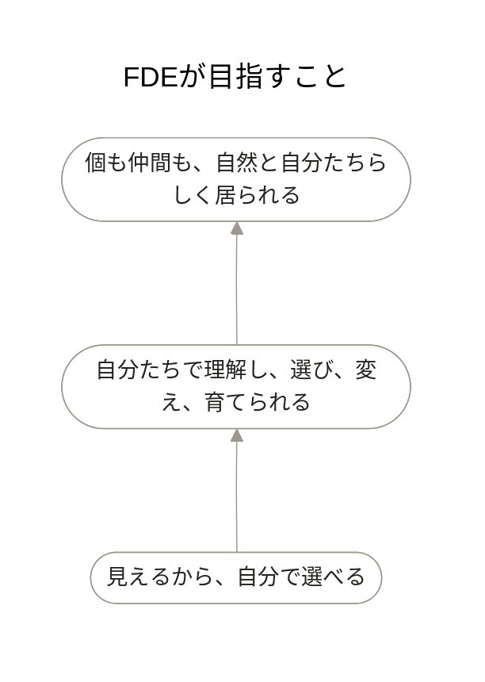

# FDE

人、AI、システムが、それぞれの強みを活かして自然に協働できる。FDEは、そんな業務の仕組みを一緒につくります。

仕組みを誰かに任せきりにはしません。使う人たち自身が理解し、選び、変え、育てていけるところまでを仕事に含めます。

このページでは、FDEの目的、関わる人、必要な状態、業務全体、三つの場面とその流れを順につなげて読めます。

案件の進め方を最初から最後まで読む場合は、[FDEの進め方](delivery-process.md)を参照してください。

## このページの構成

- [FDEが目指すこと](#fdeが目指すこと)
- [FDEを誰と実現するか](#fdeを誰と実現するか)
- [主体者が必要とする状態](#主体者が必要とする状態)
- [FDEの業務](#fdeの業務)
- [業務の変化を描く](#業務の変化を描く)
- [対象を見極め、業務を定義する](#対象を見極め業務を定義する)
- [協働の仕組みをつくる](#協働の仕組みをつくる)
- [協働を設計し、小さく確かめる](#協働を設計し小さく確かめる)
- [仕組みを現場へ根づかせる](#仕組みを現場へ根づかせる)
- [現場で使い、学びながら広げる](#現場で使い学びながら広げる)

## FDEが目指すこと

見えることは、ゴールではありません。自分たちで理解し、選び、変え、育てられる状態を支えます。

### モデル



### このモデルが表していること

業務が見えると、自分たちで選べるようになります。その理解を手元に残すことで、仕組みを自分たちで変え、育てていけます。

その先に、個も仲間も、それぞれの違いを失わず、自然と自分たちらしく居られる状態を目指します。

## FDEを誰と実現するか

この目的を実現するために、誰が一緒に仕組みを育てるのかを見ます。

主体者と仲間、fde、fdeAIが、それぞれの役割を持ってFDEを育てます。

### モデル

```mermaid
---
title: FDEを誰と実現するか
config:
  layout: dagre
  theme: neutral
  flowchart:
    curve: basis
    diagramPadding: 40
    htmlLabels: true
    nodeSpacing: 64
    rankSpacing: 80
    padding: 8
  themeVariables:
    background: "#FFFFFF"
    lineColor: "#9E988E"
    fontFamily: "Inter, Hiragino Sans, sans-serif"
    fontSize: "14px"
  themeCSS: ".image-shape p { padding: 0 !important; background-color:#FFFFFF !important; } .image-shape foreignObject { overflow: visible; } .image-shape .labelBkg { background-color:#FFFFFF !important; } .image-shape .label rect { fill:#FFFFFF !important; opacity:1 !important; } .image-shape[id*='-flowchart-b_'] .label p { margin-top: -6px !important; } .image-shape g:first-child path { stroke:#FFFFFF !important; stroke-width:6px !important; }"
---
flowchart LR
  a_maakbo_fde@{ label: "fde", img: "https://raw.githubusercontent.com/maakbo/fde/main/assets/icons/maakbo/user.svg", pos: "b", w: 38, h: 38, constraint: "on" }
  a_fde_ai@{ label: "fdeAI", img: "https://raw.githubusercontent.com/maakbo/fde/main/assets/icons/maakbo/user.svg", pos: "b", w: 38, h: 38, constraint: "on" }
  b_fde@{ label: "FDE", img: "https://raw.githubusercontent.com/maakbo/fde/main/assets/icons/maakbo/ellipse.svg", pos: "b", w: 30, h: 30, constraint: "on" }
  a_subject@{ label: "主体者", img: "https://raw.githubusercontent.com/maakbo/fde/main/assets/icons/maakbo/user.svg", pos: "b", w: 38, h: 38, constraint: "on" }
  a_companions@{ label: "主体者の仲間", img: "https://raw.githubusercontent.com/maakbo/fde/main/assets/icons/maakbo/user.svg", pos: "b", w: 38, h: 38, constraint: "on" }
  p_ultimate_purpose(["個も仲間も、自然と自分たちらしく居られる"])

  a_maakbo_fde --- b_fde
  a_fde_ai --- b_fde
  b_fde --- p_ultimate_purpose
  b_fde --- a_subject
  b_fde --- a_companions

  class a_maakbo_fde,a_fde_ai,a_subject,a_companions actor;
  class b_fde business;
  class p_ultimate_purpose purpose;

  classDef actor fill:none,stroke:none,color:#25231F;
  classDef business fill:none,stroke:none,color:#25231F;
  classDef purpose fill:#FFFFFF,stroke:#9E988E,color:#25231F,stroke-width:0.75px;
  linkStyle default stroke:#9E988E,stroke-width:0.75px;
```

### このモデルが表していること

fdeとfdeAIだけで仕組みを作るのではありません。主体者と仲間も、現場を知り、選び、使いながら、一緒に仕組みを育てます。

業務の中で役割を持つAIやシステムは、それぞれの業務を詳しく見るときに加えていきます。

## 主体者が必要とする状態

関わる人を確認したうえで、主体者が理解し、選び、改善するために必要な状態を整理します。

主体者が業務を理解し、自分で選び、改善できるように、FDEが何を支えるかを示します。

### モデル

```mermaid
---
title: 主体者が必要とする状態
config:
  layout: dagre
  theme: neutral
  flowchart:
    curve: basis
    diagramPadding: 40
    htmlLabels: true
    nodeSpacing: 44
    rankSpacing: 84
    padding: 8
  themeVariables:
    background: "#FFFFFF"
    lineColor: "#9E988E"
    fontFamily: "Inter, Hiragino Sans, sans-serif"
    fontSize: "14px"
  themeCSS: ".image-shape p { padding: 0 !important; background-color:#FFFFFF !important; } .image-shape foreignObject { overflow: visible; } .image-shape .labelBkg { background-color:#FFFFFF !important; } .image-shape .label rect { fill:#FFFFFF !important; opacity:1 !important; } .image-shape[id*='-flowchart-b_'] .label p { margin-top: -6px !important; } .image-shape g:first-child path { stroke:#FFFFFF !important; stroke-width:6px !important; }"
---
flowchart LR
  subgraph actor_lane[" "]
    direction TB
    a_maakbo_fde@{ label: "fde", img: "https://raw.githubusercontent.com/maakbo/fde/main/assets/icons/maakbo/user.svg", pos: "b", w: 38, h: 38, constraint: "on" }
    a_fde_ai@{ label: "fdeAI", img: "https://raw.githubusercontent.com/maakbo/fde/main/assets/icons/maakbo/user.svg", pos: "b", w: 38, h: 38, constraint: "on" }
    a_subject@{ label: "主体者", img: "https://raw.githubusercontent.com/maakbo/fde/main/assets/icons/maakbo/user.svg", pos: "b", w: 38, h: 38, constraint: "on" }
  end
  subgraph requirement_lane[" "]
    direction TB
    r_support(["現場の理解を支える"])
    r_agent_scope(["目的・範囲・必要情報が明確"])
    r_understand(["全体と関係を理解できる"])
    r_consider(["選択肢と影響を考えられる"])
    r_improve(["自分で選び改善できる"])
  end
  subgraph measure_lane[" "]
    direction TB
    m_shape["問いと関係を扱える形にする"]
    m_explicit["役割と制約を明示する"]
    m_visualize["関係を可視化する"]
    m_prepare["判断材料を整える"]
    m_handover["自分で扱える形へ整える"]
  end

  a_maakbo_fde --- r_support
  r_support --- m_shape
  a_fde_ai --- r_agent_scope
  r_agent_scope --- m_explicit
  a_subject --- r_understand
  r_understand --- m_visualize
  a_subject --- r_consider
  r_consider --- m_prepare
  a_subject --- r_improve
  r_improve --- m_handover

  class a_maakbo_fde,a_fde_ai,a_subject actor;
  class r_support,r_agent_scope,r_understand,r_consider,r_improve requirement;
  class m_shape,m_explicit,m_visualize,m_prepare,m_handover measure;

  classDef actor fill:none,stroke:none,color:#25231F;
  classDef requirement fill:#FFFFFF,stroke:#9E988E,color:#25231F,stroke-width:0.75px;
  classDef measure fill:#FFFFFF,stroke:#9E988E,color:#25231F,stroke-width:0.75px;
  style actor_lane fill:none,stroke:none;
  style requirement_lane fill:none,stroke:none;
  style measure_lane fill:none,stroke:none;
  linkStyle default stroke:#9E988E,stroke-width:0.75px;
```

### このモデルが表していること

見えるようにするだけでなく、選択肢と影響を考え、自分で改善できるところまでを支えます。

## FDEの業務

その状態を支える仕事を、七つの業務として捉えます。

FDEは、七つの業務を行き来しながら、現場で使い続けられる仕組みをつくります。

### モデル

```mermaid
---
title: FDEの業務
config:
  layout: dagre
  theme: neutral
  flowchart:
    curve: basis
    diagramPadding: 40
    htmlLabels: false
    nodeSpacing: 64
    rankSpacing: 80
    padding: 8
  themeVariables:
    background: "#FFFFFF"
    lineColor: "#9E988E"
    fontFamily: "Inter, Hiragino Sans, sans-serif"
    fontSize: "14px"
  themeCSS: ".image-shape p { padding: 0 !important; background-color:#FFFFFF !important; } .image-shape foreignObject { overflow: visible; } .image-shape .labelBkg { background-color:#FFFFFF !important; } .image-shape .label rect { fill:#FFFFFF !important; opacity:1 !important; } .image-shape[id*='-flowchart-b_'] .label p { margin-top: -6px !important; } .image-shape g:first-child path { stroke:#FFFFFF !important; stroke-width:6px !important; }"
---
flowchart TB
  b_fde@{ label: "FDE", img: "https://raw.githubusercontent.com/maakbo/fde/main/assets/icons/maakbo/ellipse.svg", pos: "b", w: 30, h: 30, constraint: "on" }
  b_context_understanding@{ label: "現場理解", img: "https://raw.githubusercontent.com/maakbo/fde/main/assets/icons/maakbo/ellipse.svg", pos: "b", w: 30, h: 30, constraint: "on" }
  b_business_structuring@{ label: "業務構造化", img: "https://raw.githubusercontent.com/maakbo/fde/main/assets/icons/maakbo/ellipse.svg", pos: "b", w: 30, h: 30, constraint: "on" }
  b_change_design@{ label: "変化設計", img: "https://raw.githubusercontent.com/maakbo/fde/main/assets/icons/maakbo/ellipse.svg", pos: "b", w: 30, h: 30, constraint: "on" }
  b_collaboration_design@{ label: "協働設計", img: "https://raw.githubusercontent.com/maakbo/fde/main/assets/icons/maakbo/ellipse.svg", pos: "b", w: 30, h: 30, constraint: "on" }
  b_realization@{ label: "仕組み化", img: "https://raw.githubusercontent.com/maakbo/fde/main/assets/icons/maakbo/ellipse.svg", pos: "b", w: 30, h: 30, constraint: "on" }
  b_context_fit@{ label: "現場適合", img: "https://raw.githubusercontent.com/maakbo/fde/main/assets/icons/maakbo/ellipse.svg", pos: "b", w: 30, h: 30, constraint: "on" }
  b_autonomy_transition@{ label: "自律移行", img: "https://raw.githubusercontent.com/maakbo/fde/main/assets/icons/maakbo/ellipse.svg", pos: "b", w: 30, h: 30, constraint: "on" }

  b_fde --- b_context_understanding
  b_fde --- b_business_structuring
  b_fde --- b_change_design
  b_fde --- b_collaboration_design
  b_fde --- b_realization
  b_fde --- b_context_fit
  b_fde --- b_autonomy_transition

  class b_fde,b_context_understanding,b_business_structuring,b_change_design,b_collaboration_design,b_realization,b_context_fit,b_autonomy_transition business;
  classDef business fill:none,stroke:none,color:#25231F;
  linkStyle default stroke:#9E988E,stroke-width:0.75px;
```

### このモデルが表していること

七つは工程の順番ではありません。同じ業務が複数の段階で現れ、試して分かったズレから現場理解へ戻るなど、必要な仕事を行き来します。

案件をどんな順番で進めるかは、[FDEの進め方](delivery-process.md)で見られます。

- [業務の変化を描く](#業務の変化を描く): 現場理解、業務構造化、変化設計を使って、対象選定と要件の叩き台まで進める
- [協働の仕組みをつくる](#協働の仕組みをつくる): 協働設計、仕組み化、現場適合を使って、設計と小さな検証まで進める
- [仕組みを現場へ根づかせる](#仕組みを現場へ根づかせる): 現場適合と自律移行を使って、限定導入、Outcome観測、知識循環、段階展開を進める

## 業務の変化を描く

ここからは、七つの業務を三つの場面に分けて見ます。最初は、現場の理解から対象選定と業務定義までの場面です。

主体者と仲間が、現場の実態、困りごと、暗黙知を持ち寄ります。fdeとfdeAIが言葉と絵にし、四者で業務を確かめながら、不要な仕事、ボトルネック、変える価値のある対象を見極め、設計へ渡せる要件の叩き台までつくります。

### モデル

```mermaid
---
title: 業務の変化を描く
config:
  layout: dagre
  theme: neutral
  flowchart:
    curve: basis
    diagramPadding: 40
    htmlLabels: false
    nodeSpacing: 64
    rankSpacing: 80
    padding: 8
  themeVariables:
    background: "#FFFFFF"
    lineColor: "#9E988E"
    fontFamily: "Inter, Hiragino Sans, sans-serif"
    fontSize: "14px"
  themeCSS: ".image-shape p { padding: 0 !important; background-color:#FFFFFF !important; } .image-shape foreignObject { overflow: visible; } .image-shape .labelBkg { background-color:#FFFFFF !important; } .image-shape .label rect { fill:#FFFFFF !important; opacity:1 !important; } .image-shape[id*='-flowchart-b_'] .label p { margin-top: -6px !important; } .image-shape g:first-child path { stroke:#FFFFFF !important; stroke-width:6px !important; }"
---
flowchart LR
  a_fde@{ label: "fde", img: "https://raw.githubusercontent.com/maakbo/fde/main/assets/icons/maakbo/user.svg", pos: "b", w: 38, h: 38, constraint: "on" }
  a_fde_ai@{ label: "fdeAI", img: "https://raw.githubusercontent.com/maakbo/fde/main/assets/icons/maakbo/user.svg", pos: "b", w: 38, h: 38, constraint: "on" }
  i_context_information@{ label: "業務の現状", img: "https://raw.githubusercontent.com/maakbo/fde/main/assets/icons/maakbo/file.svg", pos: "b", w: 32, h: 32, constraint: "on" }
  i_business_issue@{ label: "業務課題", img: "https://raw.githubusercontent.com/maakbo/fde/main/assets/icons/maakbo/file.svg", pos: "b", w: 32, h: 32, constraint: "on" }
  i_desired_state@{ label: "ありたい状態", img: "https://raw.githubusercontent.com/maakbo/fde/main/assets/icons/maakbo/file.svg", pos: "b", w: 32, h: 32, constraint: "on" }
  b_context_understanding@{ label: "現場理解", img: "https://raw.githubusercontent.com/maakbo/fde/main/assets/icons/maakbo/ellipse.svg", pos: "b", w: 30, h: 30, constraint: "on" }
  b_business_structuring@{ label: "業務構造化", img: "https://raw.githubusercontent.com/maakbo/fde/main/assets/icons/maakbo/ellipse.svg", pos: "b", w: 30, h: 30, constraint: "on" }
  i_business_model@{ label: "業務モデル", img: "https://raw.githubusercontent.com/maakbo/fde/main/assets/icons/maakbo/file.svg", pos: "b", w: 32, h: 32, constraint: "on" }
  b_change_design@{ label: "変化設計", img: "https://raw.githubusercontent.com/maakbo/fde/main/assets/icons/maakbo/ellipse.svg", pos: "b", w: 30, h: 30, constraint: "on" }
  i_target_priority@{ label: "対象と優先順位", img: "https://raw.githubusercontent.com/maakbo/fde/main/assets/icons/maakbo/file.svg", pos: "b", w: 32, h: 32, constraint: "on" }
  i_requirement_basis@{ label: "要件の叩き台", img: "https://raw.githubusercontent.com/maakbo/fde/main/assets/icons/maakbo/file.svg", pos: "b", w: 32, h: 32, constraint: "on" }
  a_subject@{ label: "主体者", img: "https://raw.githubusercontent.com/maakbo/fde/main/assets/icons/maakbo/user.svg", pos: "b", w: 38, h: 38, constraint: "on" }
  a_companions@{ label: "主体者の仲間", img: "https://raw.githubusercontent.com/maakbo/fde/main/assets/icons/maakbo/user.svg", pos: "b", w: 38, h: 38, constraint: "on" }

  a_fde --- b_context_understanding
  a_fde --- b_business_structuring
  a_fde --- b_change_design
  a_fde_ai --- b_context_understanding
  a_fde_ai --- b_business_structuring
  a_fde_ai --- b_change_design
  i_context_information --- b_context_understanding
  i_context_information --- b_business_structuring
  i_business_issue --- b_context_understanding
  i_business_issue --- b_change_design
  i_desired_state --- b_change_design
  b_context_understanding --- i_business_model
  b_business_structuring --- i_business_model
  i_business_model --- b_change_design
  b_change_design --- i_target_priority
  b_change_design --- i_requirement_basis
  b_context_understanding --- a_subject
  b_business_structuring --- a_subject
  b_change_design --- a_subject
  b_context_understanding --- a_companions
  b_business_structuring --- a_companions
  b_change_design --- a_companions

  class a_fde,a_fde_ai,a_subject,a_companions actor;
  class b_context_understanding,b_business_structuring,b_change_design business;
  class i_context_information,i_business_issue,i_desired_state,i_business_model,i_target_priority,i_requirement_basis information;

  classDef actor fill:none,stroke:none,color:#25231F;
  classDef business fill:none,stroke:none,color:#25231F;
  classDef information fill:none,stroke:none,color:#5F5A52;
  linkStyle default stroke:#9E988E,stroke-width:0.75px;
```

### このモデルが表していること

現場理解と業務構造化では、流れだけでなく、判断、例外、暗黙知、前提、制約まで話せる業務モデルへ近づけます。

変化設計では、まず不要な業務を減らし、残った課題のボトルネックを絞ります。人、ルール、RPA、AIエージェントなどの手段を比べ、効果、実現可能性、リスクから対象と優先順位を選びます。その対象について、範囲、対象外、前提、制約、機能・非機能要件、合格基準の叩き台を残します。

## 対象を見極め、業務を定義する

この場面で対象と要件をどう絞るかを、具体的な順序で見ます。

現場を見えるようにしたら、すぐにAI化へ進むのではなく、そもそも必要な業務かを問い直します。残った課題からボトルネックを絞り、最も意味のある対象を選び、次に設計できる要件の叩き台へ変えます。

### モデル

```mermaid
---
title: 対象を見極め、業務を定義する
config:
  layout: dagre
  theme: neutral
  flowchart:
    curve: basis
    diagramPadding: 40
    htmlLabels: false
    nodeSpacing: 52
    rankSpacing: 52
    padding: 8
  themeVariables:
    background: "#FFFFFF"
    lineColor: "#9E988E"
    primaryTextColor: "#25231F"
    edgeLabelBackground: "#FFFFFF"
    fontFamily: "Inter, Hiragino Sans, sans-serif"
    fontSize: "14px"
  themeCSS: ".image-shape p { padding: 0 !important; background-color:#FFFFFF !important; } .image-shape foreignObject { overflow: visible; } .image-shape .labelBkg { background-color:#FFFFFF !important; } .image-shape .label rect { fill:#FFFFFF !important; opacity:1 !important; } .image-shape[id*='-flowchart-b_'] .label p { margin-top: -6px !important; } .image-shape g:first-child path { stroke:#FFFFFF !important; stroke-width:6px !important; }"
---
flowchart TB
  b_overview@{ label: "業務を見渡す", img: "https://raw.githubusercontent.com/maakbo/fde/main/assets/icons/maakbo/ellipse.svg", pos: "b", w: 30, h: 30, constraint: "on" }
  b_simplify@{ label: "不要を減らす", img: "https://raw.githubusercontent.com/maakbo/fde/main/assets/icons/maakbo/ellipse.svg", pos: "b", w: 30, h: 30, constraint: "on" }
  b_bottleneck@{ label: "ボトルネックを絞る", img: "https://raw.githubusercontent.com/maakbo/fde/main/assets/icons/maakbo/ellipse.svg", pos: "b", w: 30, h: 30, constraint: "on" }
  b_choose_means@{ label: "手段を見極める", img: "https://raw.githubusercontent.com/maakbo/fde/main/assets/icons/maakbo/ellipse.svg", pos: "b", w: 30, h: 30, constraint: "on" }
  b_prioritize@{ label: "対象を選ぶ", img: "https://raw.githubusercontent.com/maakbo/fde/main/assets/icons/maakbo/ellipse.svg", pos: "b", w: 30, h: 30, constraint: "on" }
  b_scope@{ label: "境界を定める", img: "https://raw.githubusercontent.com/maakbo/fde/main/assets/icons/maakbo/ellipse.svg", pos: "b", w: 30, h: 30, constraint: "on" }
  b_requirements@{ label: "要件を言葉にする", img: "https://raw.githubusercontent.com/maakbo/fde/main/assets/icons/maakbo/ellipse.svg", pos: "b", w: 30, h: 30, constraint: "on" }

  b_overview --> b_simplify
  b_simplify --> b_bottleneck
  b_bottleneck --> b_choose_means
  b_choose_means --> b_prioritize
  b_prioritize --> b_scope
  b_scope --> b_requirements

  class b_overview,b_simplify,b_bottleneck,b_choose_means,b_prioritize,b_scope,b_requirements activity;
  classDef activity fill:none,stroke:none,color:#25231F;
  linkStyle default stroke:#9E988E,stroke-width:0.75px,fill:none;
```

### このモデルが表していること

業務を見渡すときは、流れだけでなく、判断、例外、待ち、手戻り、ミス、属人化、使う情報を確認します。不要、統合可能、順序変更可能、単純化可能な作業は、AIを使う前に減らします。

残った課題から生産性や価値を最も阻害している部分を絞り、人が担う方がよいか、ルールやRPAで扱えるか、AIエージェントが向くかを見極めます。効果の大きさ、実現可能性、リスクを合わせて、優先して試す対象を選びます。

対象を選んだら、対象業務と対象外、前提、制約、合格基準を明らかにします。機能要件だけでなく、速度、可用性、品質などの非機能要件も、実装担当者と具体化できる叩き台として言葉にします。

## 協働の仕組みをつくる

対象と要件の叩き台ができたら、関わる人と情報をもとに協働の仕組みをつくります。

対象と要件の叩き台をもとに、主体者と仲間、fde、fdeAIが、人、AI、RPA、既存システムの役割を分けます。文脈、入出力、権限、安全策を設計し、まずは安全な範囲で試せる仕組みにして、業務として成立するかを確かめます。

### モデル

```mermaid
---
title: 協働の仕組みをつくる
config:
  layout: dagre
  theme: neutral
  flowchart:
    curve: basis
    diagramPadding: 40
    htmlLabels: false
    nodeSpacing: 64
    rankSpacing: 80
    padding: 8
  themeVariables:
    background: "#FFFFFF"
    lineColor: "#9E988E"
    fontFamily: "Inter, Hiragino Sans, sans-serif"
    fontSize: "14px"
  themeCSS: ".image-shape p { padding: 0 !important; background-color:#FFFFFF !important; } .image-shape foreignObject { overflow: visible; } .image-shape .labelBkg { background-color:#FFFFFF !important; } .image-shape .label rect { fill:#FFFFFF !important; opacity:1 !important; } .image-shape[id*='-flowchart-b_'] .label p { margin-top: -6px !important; } .image-shape g:first-child path { stroke:#FFFFFF !important; stroke-width:6px !important; }"
---
flowchart LR
  a_fde@{ label: "fde", img: "https://raw.githubusercontent.com/maakbo/fde/main/assets/icons/maakbo/user.svg", pos: "b", w: 38, h: 38, constraint: "on" }
  a_fde_ai@{ label: "fdeAI", img: "https://raw.githubusercontent.com/maakbo/fde/main/assets/icons/maakbo/user.svg", pos: "b", w: 38, h: 38, constraint: "on" }
  i_business_model@{ label: "業務モデル", img: "https://raw.githubusercontent.com/maakbo/fde/main/assets/icons/maakbo/file.svg", pos: "b", w: 32, h: 32, constraint: "on" }
  i_target_priority@{ label: "対象と優先順位", img: "https://raw.githubusercontent.com/maakbo/fde/main/assets/icons/maakbo/file.svg", pos: "b", w: 32, h: 32, constraint: "on" }
  i_requirement_basis@{ label: "要件の叩き台", img: "https://raw.githubusercontent.com/maakbo/fde/main/assets/icons/maakbo/file.svg", pos: "b", w: 32, h: 32, constraint: "on" }
  b_collaboration_design@{ label: "協働設計", img: "https://raw.githubusercontent.com/maakbo/fde/main/assets/icons/maakbo/ellipse.svg", pos: "b", w: 30, h: 30, constraint: "on" }
  i_roles_constraints@{ label: "役割と責任", img: "https://raw.githubusercontent.com/maakbo/fde/main/assets/icons/maakbo/file.svg", pos: "b", w: 32, h: 32, constraint: "on" }
  i_solution_design@{ label: "仕組みの設計", img: "https://raw.githubusercontent.com/maakbo/fde/main/assets/icons/maakbo/file.svg", pos: "b", w: 32, h: 32, constraint: "on" }
  b_realization@{ label: "仕組み化", img: "https://raw.githubusercontent.com/maakbo/fde/main/assets/icons/maakbo/ellipse.svg", pos: "b", w: 30, h: 30, constraint: "on" }
  i_prototype@{ label: "試せる仕組み", img: "https://raw.githubusercontent.com/maakbo/fde/main/assets/icons/maakbo/file.svg", pos: "b", w: 32, h: 32, constraint: "on" }
  b_context_fit@{ label: "現場適合", img: "https://raw.githubusercontent.com/maakbo/fde/main/assets/icons/maakbo/ellipse.svg", pos: "b", w: 30, h: 30, constraint: "on" }
  i_poc_result@{ label: "検証結果", img: "https://raw.githubusercontent.com/maakbo/fde/main/assets/icons/maakbo/file.svg", pos: "b", w: 32, h: 32, constraint: "on" }
  a_subject@{ label: "主体者", img: "https://raw.githubusercontent.com/maakbo/fde/main/assets/icons/maakbo/user.svg", pos: "b", w: 38, h: 38, constraint: "on" }
  a_companions@{ label: "主体者の仲間", img: "https://raw.githubusercontent.com/maakbo/fde/main/assets/icons/maakbo/user.svg", pos: "b", w: 38, h: 38, constraint: "on" }

  i_business_model --- b_collaboration_design
  i_target_priority --- b_collaboration_design
  i_requirement_basis --- b_collaboration_design
  b_collaboration_design --- i_roles_constraints
  b_collaboration_design --- i_solution_design
  i_roles_constraints --- b_realization
  i_solution_design --- b_realization
  b_realization --- i_prototype
  i_prototype --- b_context_fit
  b_context_fit --- i_poc_result
  a_fde_ai --- b_context_fit
  a_fde_ai --- b_realization
  a_fde_ai --- b_collaboration_design
  a_fde --- b_context_fit
  a_fde --- b_realization
  a_fde --- b_collaboration_design
  b_collaboration_design --- a_subject
  b_realization --- a_subject
  b_context_fit --- a_subject
  b_collaboration_design --- a_companions
  b_context_fit --- a_companions

  class a_fde,a_fde_ai,a_subject,a_companions actor;
  class b_collaboration_design,b_realization,b_context_fit business;
  class i_business_model,i_target_priority,i_requirement_basis,i_roles_constraints,i_solution_design,i_prototype,i_poc_result information;

  classDef actor fill:none,stroke:none,color:#25231F;
  classDef business fill:none,stroke:none,color:#25231F;
  classDef information fill:none,stroke:none,color:#5F5A52;
  linkStyle default stroke:#9E988E,stroke-width:0.75px;
```

### このモデルが表していること

協働設計では、人に残す判断、AIに任せる処理、ルールやRPAで扱う処理、既存システムが担う処理を分けます。AIを使う場合は、目的、前提、制約、参照情報、入出力形式、Validation、権限、Human-in-the-Loop、Guardrailsまで設計します。

仕組み化では、まず試せる小さな形をつくります。現場適合では、本番へ一気に出さず、安全な環境で精度、速度、安全性、コスト、再現性、現場利用性を確認し、進める、見直す、やめるを判断します。

## 協働を設計し、小さく確かめる

この場面の設計と検証を、具体的な順序と見直しの判断で見ます。

定義した業務を、実際に試せる仕組みへ変えます。人とAIの責任を分け、AIへ渡す文脈、入出力、安全策を設計し、限られた環境で成立するかを確かめます。

### モデル

```mermaid
---
title: 協働を設計し、小さく確かめる
config:
  layout: dagre
  theme: neutral
  flowchart:
    curve: basis
    diagramPadding: 40
    htmlLabels: false
    nodeSpacing: 52
    rankSpacing: 52
    padding: 8
  themeVariables:
    background: "#FFFFFF"
    lineColor: "#9E988E"
    primaryTextColor: "#25231F"
    edgeLabelBackground: "#FFFFFF"
    fontFamily: "Inter, Hiragino Sans, sans-serif"
    fontSize: "14px"
  themeCSS: ".image-shape p { padding: 0 !important; background-color:#FFFFFF !important; } .image-shape foreignObject { overflow: visible; } .image-shape .labelBkg { background-color:#FFFFFF !important; } .image-shape .label rect { fill:#FFFFFF !important; opacity:1 !important; } .image-shape[id*='-flowchart-b_'] .label p { margin-top: -6px !important; } .image-shape g:first-child path { stroke:#FFFFFF !important; stroke-width:6px !important; }"
---
flowchart TB
  b_split_roles@{ label: "役割を分ける", img: "https://raw.githubusercontent.com/maakbo/fde/main/assets/icons/maakbo/ellipse.svg", pos: "b", w: 30, h: 30, constraint: "on" }
  b_design_context@{ label: "文脈を設計する", img: "https://raw.githubusercontent.com/maakbo/fde/main/assets/icons/maakbo/ellipse.svg", pos: "b", w: 30, h: 30, constraint: "on" }
  b_design_io@{ label: "入出力と安全を決める", img: "https://raw.githubusercontent.com/maakbo/fde/main/assets/icons/maakbo/ellipse.svg", pos: "b", w: 30, h: 30, constraint: "on" }
  b_prototype@{ label: "試せる形にする", img: "https://raw.githubusercontent.com/maakbo/fde/main/assets/icons/maakbo/ellipse.svg", pos: "b", w: 30, h: 30, constraint: "on" }
  b_verify@{ label: "成立性を確かめる", img: "https://raw.githubusercontent.com/maakbo/fde/main/assets/icons/maakbo/ellipse.svg", pos: "b", w: 30, h: 30, constraint: "on" }
  d_ready@{ label: "本番へ進める?", img: "https://raw.githubusercontent.com/maakbo/fde/main/assets/icons/maakbo/diamond.svg", pos: "b", w: 38, h: 38, constraint: "on" }
  b_prepare@{ label: "導入を準備する", img: "https://raw.githubusercontent.com/maakbo/fde/main/assets/icons/maakbo/ellipse.svg", pos: "b", w: 30, h: 30, constraint: "on" }
  b_rework@{ label: "設計を見直す", img: "https://raw.githubusercontent.com/maakbo/fde/main/assets/icons/maakbo/ellipse.svg", pos: "b", w: 30, h: 30, constraint: "on" }

  b_split_roles --> b_design_context
  b_design_context --> b_design_io
  b_design_io --> b_prototype
  b_prototype --> b_verify
  b_verify --> d_ready
  d_ready -->|進める| b_prepare
  d_ready -->|見直す| b_rework
  b_rework --> b_design_context

  class b_split_roles,b_design_context,b_design_io,b_prototype,b_verify,b_prepare,b_rework activity;
  class d_ready decision;
  classDef activity fill:none,stroke:none,color:#25231F;
  classDef decision fill:none,stroke:none,color:#25231F;
  linkStyle default stroke:#9E988E,stroke-width:0.75px,fill:none;
```

### このモデルが表していること

役割分担では、人に残す判断、AIに任せる処理、ルールやRPAで扱う処理、既存システムが担う処理を明らかにします。文脈設計では、目的、前提、制約、参照情報、判断例を揃えます。

入出力と安全の設計では、入力データ、JSONなどの出力形式、Schema、Validation、権限、機密性、Human-in-the-Loop、Guardrailsを決めます。必要な論点は、実装担当者だけでなく情報セキュリティや法務とも具体化します。

試作後はSandboxなどの安全な環境で、精度、速度、安全性、再現性、コスト、現場での使いやすさを確認します。合格基準を満たさないときは、設計を見直して再検証するか、方法を変えるか、導入をやめるかを判断します。

## 仕組みを現場へ根づかせる

小さな検証で成立した仕組みを、次は現場で使い、主体者と仲間が育てられる状態へつなげます。

検証で成立した仕組みを、主体者と仲間が限定した範囲から使います。fdeとfdeAIは、利用結果だけでなく業務や人に起きた変化を一緒に確かめ、現場の判断や知見を仕組みへ戻します。使う人たちが自分で理解し、変え、育てられる状態へ移していきます。

### モデル

```mermaid
---
title: 仕組みを現場へ根づかせる
config:
  layout: dagre
  theme: neutral
  flowchart:
    curve: basis
    diagramPadding: 40
    htmlLabels: false
    nodeSpacing: 64
    rankSpacing: 80
    padding: 8
  themeVariables:
    background: "#FFFFFF"
    lineColor: "#9E988E"
    fontFamily: "Inter, Hiragino Sans, sans-serif"
    fontSize: "14px"
  themeCSS: ".image-shape p { padding: 0 !important; background-color:#FFFFFF !important; } .image-shape foreignObject { overflow: visible; } .image-shape .labelBkg { background-color:#FFFFFF !important; } .image-shape .label rect { fill:#FFFFFF !important; opacity:1 !important; } .image-shape[id*='-flowchart-b_'] .label p { margin-top: -6px !important; } .image-shape g:first-child path { stroke:#FFFFFF !important; stroke-width:6px !important; }"
---
flowchart LR
  a_fde@{ label: "fde", img: "https://raw.githubusercontent.com/maakbo/fde/main/assets/icons/maakbo/user.svg", pos: "b", w: 38, h: 38, constraint: "on" }
  a_fde_ai@{ label: "fdeAI", img: "https://raw.githubusercontent.com/maakbo/fde/main/assets/icons/maakbo/user.svg", pos: "b", w: 38, h: 38, constraint: "on" }
  i_poc_result@{ label: "検証結果", img: "https://raw.githubusercontent.com/maakbo/fde/main/assets/icons/maakbo/file.svg", pos: "b", w: 32, h: 32, constraint: "on" }
  i_roles_constraints@{ label: "役割と責任", img: "https://raw.githubusercontent.com/maakbo/fde/main/assets/icons/maakbo/file.svg", pos: "b", w: 32, h: 32, constraint: "on" }
  i_usage_result@{ label: "利用結果", img: "https://raw.githubusercontent.com/maakbo/fde/main/assets/icons/maakbo/file.svg", pos: "b", w: 32, h: 32, constraint: "on" }
  i_outcome@{ label: "業務の成果", img: "https://raw.githubusercontent.com/maakbo/fde/main/assets/icons/maakbo/file.svg", pos: "b", w: 32, h: 32, constraint: "on" }
  i_feedback@{ label: "現場の知見", img: "https://raw.githubusercontent.com/maakbo/fde/main/assets/icons/maakbo/file.svg", pos: "b", w: 32, h: 32, constraint: "on" }
  b_context_fit@{ label: "現場適合", img: "https://raw.githubusercontent.com/maakbo/fde/main/assets/icons/maakbo/ellipse.svg", pos: "b", w: 30, h: 30, constraint: "on" }
  i_business_model@{ label: "業務モデル", img: "https://raw.githubusercontent.com/maakbo/fde/main/assets/icons/maakbo/file.svg", pos: "b", w: 32, h: 32, constraint: "on" }
  i_work_system@{ label: "業務の仕組み", img: "https://raw.githubusercontent.com/maakbo/fde/main/assets/icons/maakbo/file.svg", pos: "b", w: 32, h: 32, constraint: "on" }
  i_knowledge@{ label: "共有知識", img: "https://raw.githubusercontent.com/maakbo/fde/main/assets/icons/maakbo/file.svg", pos: "b", w: 32, h: 32, constraint: "on" }
  b_autonomy_transition@{ label: "自律移行", img: "https://raw.githubusercontent.com/maakbo/fde/main/assets/icons/maakbo/ellipse.svg", pos: "b", w: 30, h: 30, constraint: "on" }
  a_subject@{ label: "主体者", img: "https://raw.githubusercontent.com/maakbo/fde/main/assets/icons/maakbo/user.svg", pos: "b", w: 38, h: 38, constraint: "on" }
  a_companions@{ label: "主体者の仲間", img: "https://raw.githubusercontent.com/maakbo/fde/main/assets/icons/maakbo/user.svg", pos: "b", w: 38, h: 38, constraint: "on" }

  a_fde_ai --- b_autonomy_transition
  a_fde_ai --- b_context_fit
  a_fde --- b_autonomy_transition
  a_fde --- b_context_fit
  i_knowledge --- b_autonomy_transition
  i_work_system --- b_autonomy_transition
  i_business_model --- b_autonomy_transition
  b_context_fit --- i_knowledge
  b_context_fit --- i_work_system
  b_context_fit --- i_business_model
  i_feedback --- b_context_fit
  i_outcome --- b_context_fit
  i_usage_result --- b_context_fit
  i_roles_constraints --- b_autonomy_transition
  i_roles_constraints --- b_context_fit
  i_poc_result --- b_context_fit
  b_context_fit --- a_subject
  b_autonomy_transition --- a_subject
  b_context_fit --- a_companions
  b_autonomy_transition --- a_companions

  class a_fde,a_fde_ai,a_subject,a_companions actor;
  class b_context_fit,b_autonomy_transition business;
  class i_poc_result,i_roles_constraints,i_usage_result,i_outcome,i_feedback,i_business_model,i_work_system,i_knowledge information;

  classDef actor fill:none,stroke:none,color:#25231F;
  classDef business fill:none,stroke:none,color:#25231F;
  classDef information fill:none,stroke:none,color:#5F5A52;
  linkStyle default stroke:#9E988E,stroke-width:0.75px;
```

### このモデルが表していること

現場適合では、限定した範囲で利用を始め、利用件数などのOutputだけでなく、処理時間、手戻り、判断の一致、利用者への価値などのOutcomeを追います。短期で分かる変化と、時間をかけて追う変化を分けます。

使う中で担当者が得た感覚や判断を現場の知見として言葉にし、業務モデル、プロンプト、ルール、ナレッジへ戻します。改善された仕組みを使うことで人側の判断も育ち、人とAIの知識が循環する状態をつくります。

自律移行では、運営、判断、変更の責任を主体者と仲間へ移します。同じ仕組みを広げるときは段階的に利用者を増やし、新しい機能や別業務へ広げる場合は改めて対象と価値を見極めます。

## 現場で使い、学びながら広げる

この場面の導入、観測、改善、展開を、具体的な順序で見ます。

検証で成立した仕組みを、限定した範囲から使い始めます。使った量だけでなく、業務や人にどんな変化が起きたかを確かめ、現場の知見を仕組みへ戻しながら育てます。

### モデル

```mermaid
---
title: 現場で使い、学びながら広げる
config:
  layout: dagre
  theme: neutral
  flowchart:
    curve: basis
    diagramPadding: 40
    htmlLabels: false
    nodeSpacing: 52
    rankSpacing: 52
    padding: 8
  themeVariables:
    background: "#FFFFFF"
    lineColor: "#9E988E"
    primaryTextColor: "#25231F"
    edgeLabelBackground: "#FFFFFF"
    fontFamily: "Inter, Hiragino Sans, sans-serif"
    fontSize: "14px"
  themeCSS: ".image-shape p { padding: 0 !important; background-color:#FFFFFF !important; } .image-shape foreignObject { overflow: visible; } .image-shape .labelBkg { background-color:#FFFFFF !important; } .image-shape .label rect { fill:#FFFFFF !important; opacity:1 !important; } .image-shape[id*='-flowchart-b_'] .label p { margin-top: -6px !important; } .image-shape g:first-child path { stroke:#FFFFFF !important; stroke-width:6px !important; }"
---
flowchart TB
  b_limited_rollout@{ label: "限定導入する", img: "https://raw.githubusercontent.com/maakbo/fde/main/assets/icons/maakbo/ellipse.svg", pos: "b", w: 30, h: 30, constraint: "on" }
  b_observe_use@{ label: "利用を観測する", img: "https://raw.githubusercontent.com/maakbo/fde/main/assets/icons/maakbo/ellipse.svg", pos: "b", w: 30, h: 30, constraint: "on" }
  b_measure_outcome@{ label: "成果を測る", img: "https://raw.githubusercontent.com/maakbo/fde/main/assets/icons/maakbo/ellipse.svg", pos: "b", w: 30, h: 30, constraint: "on" }
  b_update_knowledge@{ label: "知識を更新する", img: "https://raw.githubusercontent.com/maakbo/fde/main/assets/icons/maakbo/ellipse.svg", pos: "b", w: 30, h: 30, constraint: "on" }
  b_improve@{ label: "仕組みを改善する", img: "https://raw.githubusercontent.com/maakbo/fde/main/assets/icons/maakbo/ellipse.svg", pos: "b", w: 30, h: 30, constraint: "on" }
  d_expand@{ label: "利用を広げる?", img: "https://raw.githubusercontent.com/maakbo/fde/main/assets/icons/maakbo/diamond.svg", pos: "b", w: 38, h: 38, constraint: "on" }
  b_rollout@{ label: "利用を広げる", img: "https://raw.githubusercontent.com/maakbo/fde/main/assets/icons/maakbo/ellipse.svg", pos: "b", w: 30, h: 30, constraint: "on" }
  b_continue@{ label: "限定で続ける", img: "https://raw.githubusercontent.com/maakbo/fde/main/assets/icons/maakbo/ellipse.svg", pos: "b", w: 30, h: 30, constraint: "on" }

  b_limited_rollout --> b_observe_use
  b_observe_use --> b_measure_outcome
  b_measure_outcome --> b_update_knowledge
  b_update_knowledge --> b_improve
  b_improve --> d_expand
  d_expand -->|広げる| b_rollout
  d_expand -->|続ける| b_continue
  b_continue --> b_observe_use

  class b_limited_rollout,b_observe_use,b_measure_outcome,b_update_knowledge,b_improve,b_rollout,b_continue activity;
  class d_expand decision;
  classDef activity fill:none,stroke:none,color:#25231F;
  classDef decision fill:none,stroke:none,color:#25231F;
  linkStyle default stroke:#9E988E,stroke-width:0.75px,fill:none;
```

### このモデルが表していること

最初は同じ仕組みを限られた利用者や範囲で使い、現場とのズレを集めます。利用件数などのOutputだけでなく、処理時間、手戻り、判定の一致、顧客や利用者への価値などのOutcomeを見ます。短期で分かる変化と、時間をかけて追う変化は分けて扱います。

担当者が使う中で得た感覚や判断は、言葉にしてプロンプト、ルール、業務モデル、ナレッジベースへ戻します。改善された仕組みから人も新しい判断を学び、人とAIの両方が育つ循環をつくります。

同じ機能をより多くの利用者へ届けるときは段階的に広げます。処理能力を高める、新しい機能を追加する、別の業務へ適用する場合は、単なる利用者拡大とは分けて考え、必要なら再び対象の見極めから始めます。
