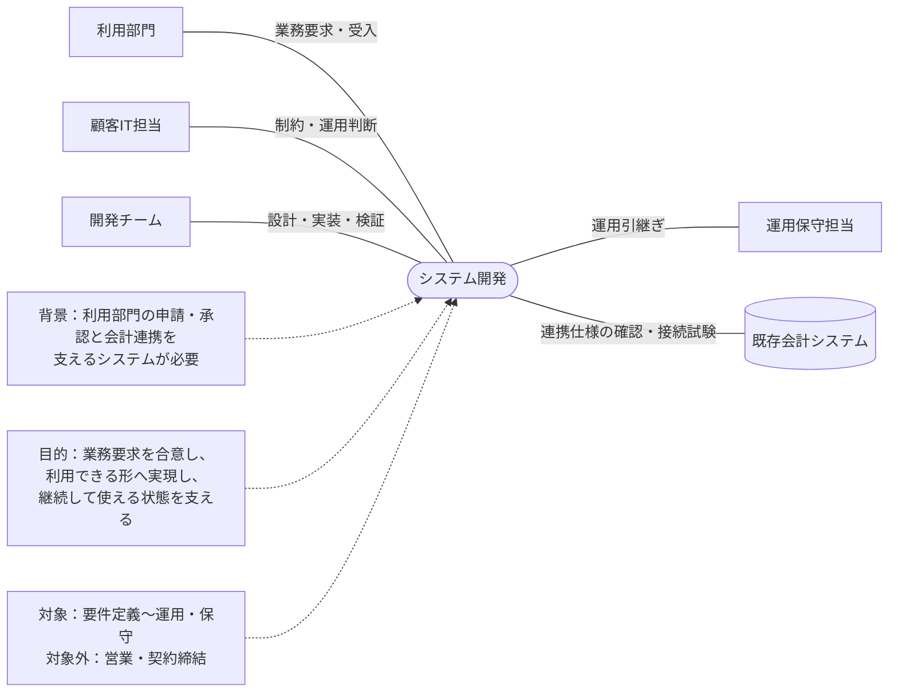
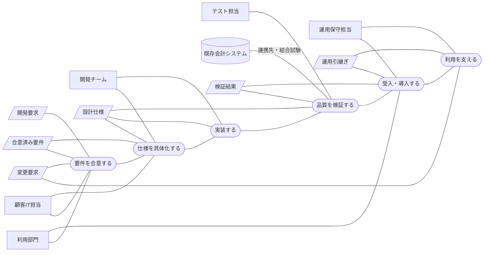

# システム開発

**人が担うシステム開発のAs-Is（架空の例）**。要件定義から運用・保守までを対象に、RDRAの考え方を参考にして、仕事の背景・目的から業務・作業・情報まで一続きで読むための試作です。ソフトウェアそのもののアーキテクチャ図ではなく、ソフトウェアを作り、利用を支える**仕事**を可視化しています。

> 実案件の事実・標準手順ではありません。ここでは法人顧客の申請・承認Webシステムと既存会計システムの連携を、架空の開発対象として置いています。すべての業務判断、作成、レビュー、テスト操作、導入判断は人が行い、AI/自動化をAs-Isへ混ぜません。

## システムコンテキスト — なぜ、誰と、どこまで

利用部門が使う申請・承認の仕組みを、顧客IT担当と開発チームが要件から実装・検証まで具体化し、受入・導入後も運用保守担当が利用を支えます。既存会計システムは**開発対象の連携先**であり、開発業務全体を実行するシステムではありません。着手契機は、契約などの前提が整った後の開発依頼です。

## ビジネスコンテキスト — 業務、関係者、情報のつながり

業務名は、工程名の言い換えではなく**何を何に変えるか**で仮置きしています。線は、参加・情報の参照や作成・成果の受渡しの**関係**です。細かい時系列や分岐をこの図へ押し込まず、選んだ業務の[ビジネスユースケース](basic-design/README.md)と[業務フロー](basic-design/review-flow.md)で表現します。

この図の主要情報は、独立した[情報モデル](information-model.md)でも同じ意味・IDで扱います。下位モデルで情報や責任が変わったら、この図へ戻して更新します。

## フェーズ — 業務を探すための入口

フェーズは開発の進行を眺める**索引**です。意味上の分解は「仕事 → 業務 → 子業務 → 作業」。一つの業務は複数フェーズにまたがる場合があります。

| フェーズ | 関係する業務（上図） | 掘り下げ先 |
| --- | --- | --- |
| 要件定義 | 要件を合意する | [既存As-Is](../requirements/) |
| 基本設計 | 仕様を具体化する | **[ビジネスユースケースを展開](basic-design/README.md)** |
| 詳細設計 | 仕様を具体化する | [既存As-Is](../detailed-design/) |
| 実装・単体テスト | 実装する・品質を検証する | [既存As-Is](../implementation/) |
| 内部結合テスト | 品質を検証する | [既存As-Is](../internal-integration/) |
| 外部結合テスト | 品質を検証する（既存会計との連携） | [既存As-Is](../external-integration/) |
| システムテスト | 品質を検証する | [既存As-Is](../system-test/) |
| ユーザー受入テスト | 受入・導入する | [既存As-Is](../user-acceptance/) |
| 導入 | 受入・導入する・利用を支える | [既存As-Is](../deployment/) |
| 運用・保守 | 利用を支える・変更を要件へ返す | [既存As-Is](../operations/) |

## 次に見る

**[基本設計のビジネスユースケース](basic-design/README.md)** → **[設計レビューの業務フロー（担当者別スイムレーン）](basic-design/review-flow.md)** ／ **[情報モデル](information-model.md)**

自分の業務に使う場合は、**[実案件への転用手順](USE.md)** から、AIエージェントと対話して仮モデルを作成・修正します。実業務の資料をこの公開リポジトリへ載せることは前提としません。

[従来のAs-Isへ戻る](../README.md)
