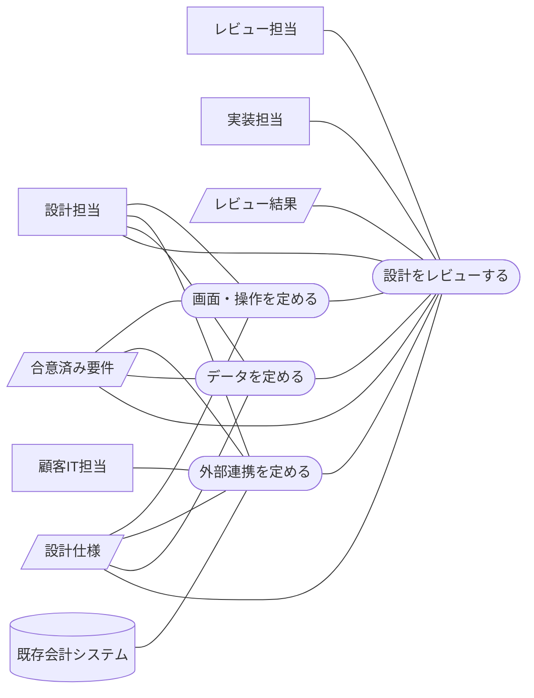

# 基本設計 — ビジネスユースケース

[システム開発の全体に戻る](../README.md)

「仕様を具体化する」という親業務を展開します。ここでは、承認済み要件を受け取り、開発・検証担当が実装や確認に使える設計仕様に具体化する場面を扱います。対象は架空の受託開発As-Isです。

画面・外部連携・データの設計は、親業務を具体化する子業務です。レビューでは、合意済み要件と設計仕様を照合し、指摘や修正の結果を次の判断に渡します。実装担当は成果を受け取る役割であり、実務でレビューへ参加するかは現場確認の対象です。

**この業務で扱う情報**は[情報モデル](../information-model.md)の「合意済み要件」「設計仕様」「レビュー結果」と同じ意味で使います。

**次の展開**： [設計レビューの業務フロー](review-flow.md) — 誰がどの順に確認し、修正や引渡しを行うか。

この初版は設計者・レビュアーの役割や作業を仮置きしたものです。実際の組織構造・レビュー方式・承認権限を断定しません。
