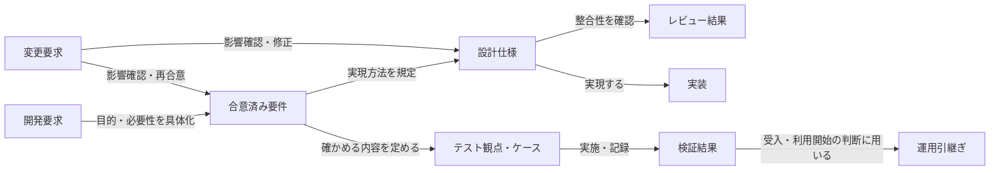

# システム開発 — 情報モデル

[システム開発の全体に戻る](README.md) / [基本設計のビジネスユースケース](basic-design/README.md)

業務で扱う**情報の意味**を明確にするモデルです。文書形式の一覧や工程順ではありません。「要求」「要件」「設計」「レビュー」「テスト」「変更」を別の概念として定義し、業務の間で同じ言葉を使います。

| 安定ID | 用語 | 意味 | 主な利用場面 |
| --- | --- | --- | --- |
| `i_request` | 開発要求 | 誰が何を必要としているかという依頼・背景 | 要件定義 |
| `i_requirements` | 合意済み要件 | 対象業務・機能・品質・受入条件について合意した期待 | 要件定義、設計、検証 |
| `i_design` | 設計仕様 | 画面・API・データ・処理等を実装/確認できる粒度に具体化した取り決め | 基本/詳細設計、実装、検証 |
| `i_review` | レビュー結果 | 確認した対象版、論点、指摘、判断と対応の記録 | 設計レビュー |
| `i_code` | 実装 | 実行できるソフトウェアと対応する設定・コード | 実装、検証、運用 |
| `i_cases` | テスト観点・ケース | 何をどの条件で確認し、どんな結果を期待するか | 単体～受入テスト |
| `i_results` | 検証結果 | どの版を、どんな条件で確認し、何が観測されたか | テスト、受入判断 |
| `i_handover` | 運用引継ぎ | 運用を担うために必要な構成・手順・残件・責任の引渡し | 導入、運用保守 |
| `i_change` | 変更要求 | 現行の振る舞い・仕様・運用への変更提案と理由 | 運用、再計画・要件定義 |

**重要**：上の矢印は概念間の意味的な関係であり、すべての案件が図の順序で一度ずつ進む、という意味ではありません。たとえばテスト観点は設計より前から考えることがあります。要件/設計との多対多の実際の追跡粒度、承認済みの状態遷移、既存の正本の位置は、実際の業務に合わせて決めます。

詳細の業務で用語が変わったら、ここのIDと定義を先に更新し、上位のコンテキスト・子業務・フローの参照を照合してください。
