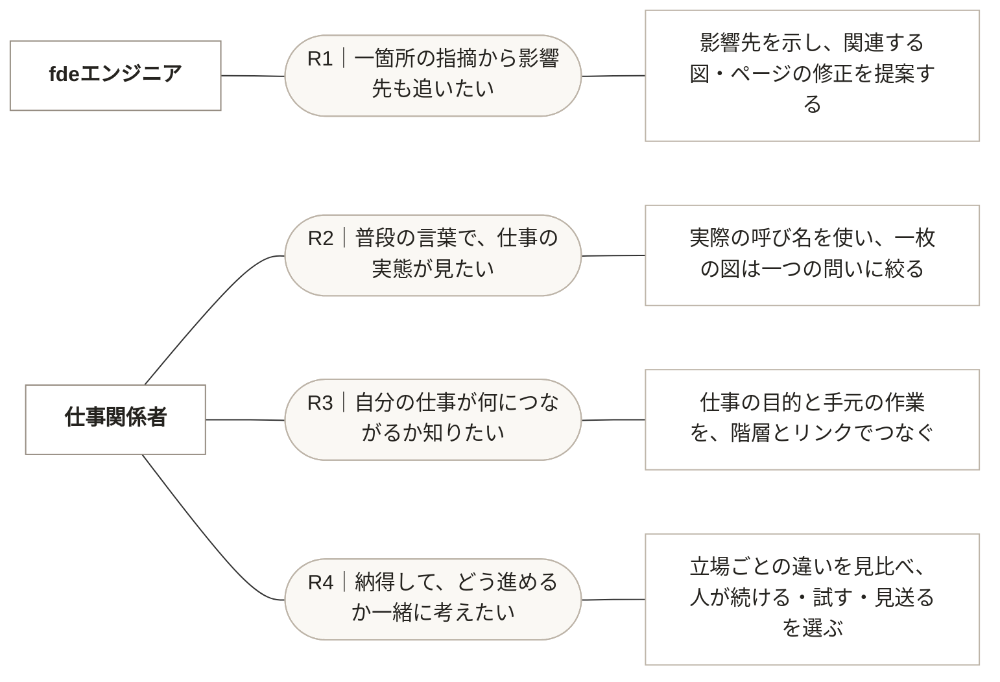

# fdeを育てる：アクターの役割と要求モデル

[テーマコンテキスト図](theme-context.md)の次に読む一枚。対象は **fdeというプロダクトをつくり、仕事で使いながら磨く活動**。個々の仕事の担当者や業務要件は、それぞれのテーマで別に整理する。

## アクターの役割

| アクター | このテーマでの役割 |
| --- | --- |
| fdeエンジニア | fdeの目的と設計を整え、使って分かったことをもとに、何を採用し何を見送るか判断する。自分で試すときは、仕事関係者としての視点も持つ。 |
| fde AI | 会話から仕事の要素・名前・関係を図と言葉にし、指摘が入ったら関連箇所と修正案を示す。採用や仕事の進め方を決めるのは人。 |
| 仕事関係者 | 仕事を進める人、判断や支援を担う人、その仕事の価値を受け取る人。立場ごとの見え方や、図と実際の仕事のズレを持ち寄る。 |
| GitHub | 図のソース、関連ページ、変更履歴を置く外部システム。要求の発言者ではなく、保存・共有・追跡を支える手段。 |

## 要求モデル図（初稿）

左にアクター、中央にその立場からの要求、右に応え方の案。要求文は会話をもとにした要約で、発言の引用ではない。仕事関係者の要求は、実際に使う人と照らし合わせたい仮説。

## 応え方の判断

| ID | 判断のたたき台 |
| --- | --- |
| R1 | **対応案あり。** 図・ページ・手順のどこに波及するか確認する。似た箇所は提案までとし、一括変更はしない。fde AIが担当し、修正理由をGitHubで追えるようにする。 |
| R2 | **対応案あり。** 用語は関係者が実際に使う言葉から始める。一枚に入りきらない情報は別の図・ページへ。どの粒度なら「そうそう、これ」となるかは未検証。 |
| R3 | **対応案あり。** ルートの目的から仕事・業務・作業へたどれ、手元の作業からも目的に戻れるようにする。階層をまたぐ関係はリンクで残す。 |
| R4 | **対応案あり。** 可視化で止まらず、試す場合は結果を見て判断し、仕事とモデルを更新する。今のやり方に納得して続けることも成果。改善を強制したり、AIが代わりに決めたりはしない。 |

fde AIには「名称が違うだけか、意味も違うかを区別する」、GitHubには「MarkdownとMermaidのソースを人もAIも読め、変更を追える」という**実現上の条件**を置く。どちらも利用者の要求とは混ぜない。次に確かめたいのは「仕事関係者」の中で、進める人・判断する人・受け取る人をどこで分けると実際の違いが見えてくるか。図の数や機能の追加は、その確認のあとに決める。
