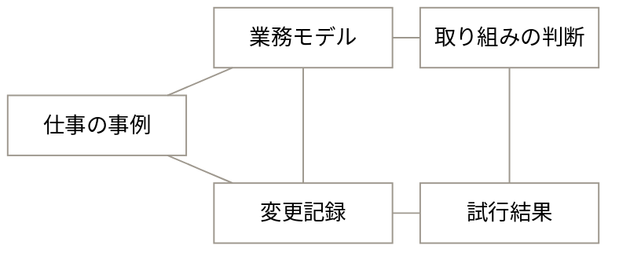

<a name="theme"></a>

# maakbo fde

```mermaid
---
config:
  layout: dagre
  theme: neutral
  flowchart:
    curve: basis
    diagramPadding: 24
    htmlLabels: false
    wrappingWidth: 280
    nodeSpacing: 38
    rankSpacing: 58
    padding: 18
  themeVariables:
    background: "#FFFFFF"
    lineColor: "#8A847A"
    fontFamily: "Inter, Hiragino Sans, sans-serif"
    fontSize: "14px"
  themeCSS: ".image-shape p { padding: 0 !important; background-color:#FFFFFF !important; } .image-shape foreignObject { overflow: visible; } .image-shape .labelBkg { background-color:#FFFFFF !important; } .image-shape .label rect { fill:#FFFFFF !important; opacity:1 !important; } .image-shape[id*='-flowchart-b_'] .label p { margin-top: -6px !important; } .image-shape g:first-child path { stroke:#FFFFFF !important; stroke-width:6px !important; }"
---
flowchart LR
  accTitle: fdeを育てる仕事の関係
  %% テーマコンテキスト図：製品を育てる活動。fdeで描く個々の仕事は別のテーマ。
  %% 右の仕事関係者は一つのアクター群。複数人を表すが、人数や内訳は特定しない。
  %% 点線は目指すゴールを添えるための注釈。業務フローではない。
  a_product_owner@{ label: "fdeエンジニア", img: "https://raw.githubusercontent.com/maakbo/fde/main/assets/icons/maakbo/user.svg", pos: "b", w: 28, h: 28, constraint: "on" }
  a_build_agent@{ label: "fde AI", img: "https://raw.githubusercontent.com/maakbo/fde/main/assets/icons/maakbo/bot.svg", pos: "b", w: 28, h: 28, constraint: "on" }
  b_fde_product("fdeを育てる")
  a_work_members@{ label: "仕事関係者", img: "https://raw.githubusercontent.com/maakbo/fde/523072a59582f5d41d998c1b2f65929afc47270d/experiments/fde-product-pivot/work-group.svg", pos: "b", w: 28, h: 28, constraint: "on" }
  x_github@{ label: "GitHub", img: "https://raw.githubusercontent.com/maakbo/fde/main/assets/icons/maakbo/server.svg", pos: "b", w: 28, h: 28, constraint: "on" }
  goal["仕事をAIと一緒に可視化して、<br/>関わるものたちが納得して進められて、<br/>仕事がうまくいきます。"]

  a_product_owner --- b_fde_product
  a_build_agent --- b_fde_product
  b_fde_product -.- goal
  b_fde_product --- a_work_members
  b_fde_product --- x_github

  classDef icon fill:none,stroke:none,color:#25231F;
  classDef compass fill:none,stroke:none,color:#25231F,font-weight:600;
  classDef themeNode fill:#FFFFFF,stroke:#4A4640,stroke-width:1.25px,color:#25231F,font-weight:700,font-size:23px;
  class a_product_owner,a_build_agent,a_work_members,x_github icon;
  class goal compass;
  class b_fde_product themeNode;
  linkStyle default stroke:#9E988E,stroke-width:0.75px;
  linkStyle 2 stroke:#A0988E,stroke-width:1px,stroke-dasharray:2 4;
```

立場によって、同じ仕事でも見えていることが違います。fdeは、関係者がAIと一緒に仕事を図にし、互いの前提を確かめて進め方を決めるための仕組みです。ここで扱うのは、fdeを実際の仕事で使いながら育てる活動です。

<a name="関わる人と仕組み"></a>

| 関係者・仕組み | 役割 |
| --- | --- |
| <a name="actor-product-owner"></a>fdeエンジニア | 試行や指摘をもとに、fdeのやり方や図の型を見直す。 |
| <a name="actor-build-agent"></a>fde AI | 話を図と記録にし、進め方の案や変更の影響先を示す。 |
| <a name="actor-work-members"></a>仕事関係者 | 仕事の実態を持ち寄って確かめ、進め方を選ぶ。 |
| <a name="github"></a>GitHub | 図と記録を共有し、何をなぜ変えたかを残す。 |

目次：[業務](#業務) · [要求](#要求) · [情報](#情報) · [用語集](#用語集)

<a name="questions"></a>
<a name="scope-decide"></a>
<a name="try-revise"></a>

## 業務

```mermaid
---
config:
  layout: dagre
  theme: neutral
  flowchart:
    curve: basis
    htmlLabels: false
    wrappingWidth: 180
    nodeSpacing: 28
    rankSpacing: 54
  themeVariables:
    lineColor: "#9E988E"
    fontFamily: "Inter, Hiragino Sans, sans-serif"
    fontSize: "14px"
---
flowchart LR
  accTitle: fdeを育てる業務
  accDescr: 左は人とAI、中央は四つの業務、右は各業務で扱う情報とGitHub。線は関係で、手順は業務ごとのページにある。
  %% 業務は同じ粒度で並べる。情報の生成・参照・受け渡しは本文と詳細に置き、作業順を表さない。
  a_work_members@{ label: "仕事関係者", img: "https://raw.githubusercontent.com/maakbo/fde/523072a59582f5d41d998c1b2f65929afc47270d/experiments/fde-product-pivot/work-group.svg", pos: "b", w: 28, h: 28, constraint: "on" }
  a_build_agent@{ label: "fde AI", img: "https://raw.githubusercontent.com/maakbo/fde/main/assets/icons/maakbo/bot.svg", pos: "b", w: 28, h: 28, constraint: "on" }
  a_product_owner@{ label: "fdeエンジニア", img: "https://raw.githubusercontent.com/maakbo/fde/main/assets/icons/maakbo/user.svg", pos: "b", w: 28, h: 28, constraint: "on" }
  x_github@{ label: "GitHub", img: "https://raw.githubusercontent.com/maakbo/fde/main/assets/icons/maakbo/server.svg", pos: "b", w: 28, h: 28, constraint: "on" }

  b_understand@{ label: "業務可視化", img: "https://raw.githubusercontent.com/maakbo/fde/main/assets/icons/maakbo/ellipse.svg", pos: "b", w: 28, h: 28, constraint: "on" }
  b_decide@{ label: "方針選定", img: "https://raw.githubusercontent.com/maakbo/fde/main/assets/icons/maakbo/ellipse.svg", pos: "b", w: 28, h: 28, constraint: "on" }
  b_validate@{ label: "試行・評価", img: "https://raw.githubusercontent.com/maakbo/fde/main/assets/icons/maakbo/ellipse.svg", pos: "b", w: 28, h: 28, constraint: "on" }
  b_maintain@{ label: "業務・モデル見直し", img: "https://raw.githubusercontent.com/maakbo/fde/main/assets/icons/maakbo/ellipse.svg", pos: "b", w: 28, h: 28, constraint: "on" }

  i_work_example@{ label: "仕事の事例", img: "https://raw.githubusercontent.com/maakbo/fde/main/assets/icons/maakbo/file.svg", pos: "b", w: 28, h: 28, constraint: "on" }
  i_work_model@{ label: "業務モデル", img: "https://raw.githubusercontent.com/maakbo/fde/main/assets/icons/maakbo/file.svg", pos: "b", w: 28, h: 28, constraint: "on" }
  i_direction@{ label: "取り組みの判断", img: "https://raw.githubusercontent.com/maakbo/fde/main/assets/icons/maakbo/file.svg", pos: "b", w: 28, h: 28, constraint: "on" }
  i_trial@{ label: "試行結果", img: "https://raw.githubusercontent.com/maakbo/fde/main/assets/icons/maakbo/file.svg", pos: "b", w: 28, h: 28, constraint: "on" }
  i_change@{ label: "変更記録", img: "https://raw.githubusercontent.com/maakbo/fde/main/assets/icons/maakbo/file.svg", pos: "b", w: 28, h: 28, constraint: "on" }

  a_work_members --- b_understand
  a_work_members --- b_decide
  a_work_members --- b_validate
  a_work_members --- b_maintain
  a_build_agent --- b_understand
  a_build_agent --- b_maintain
  a_product_owner --- b_decide
  a_product_owner --- b_maintain
  b_understand --- i_work_example
  b_understand --- i_work_model
  b_decide --- i_work_model
  b_decide --- i_direction
  b_validate --- i_direction
  b_validate --- i_trial
  b_maintain --- i_trial
  b_maintain --- i_work_example
  b_maintain --- i_work_model
  b_maintain --- i_change
  b_maintain --- x_github

  class a_work_members,a_build_agent,a_product_owner actor;
  class x_github system;
  class b_understand,b_decide,b_validate,b_maintain business;
  class i_work_example,i_work_model,i_direction,i_trial,i_change information;
  classDef actor fill:none,stroke:none,color:#25231F;
  classDef system fill:none,stroke:none,color:#25231F;
  classDef business fill:none,stroke:none,color:#25231F;
  classDef information fill:none,stroke:none,color:#25231F;
  linkStyle default stroke:#9E988E,stroke-width:0.75px;
```

- <a name="uc-understand"></a>[業務可視化](work/understand/README.md)：仕事関係者が実際に起きた一件を話し、fde AIが目的・役割・受け渡しを業務モデルにする。仕事関係者が実態と照らし合わせ、fdeエンジニアが確認済みの内容と未確認点を業務モデルに残す。
- <a name="uc-decide"></a>[方針選定](work/decide/README.md)：fde AIが業務モデルをもとに案を並べ、仕事関係者が続ける・試す・見送るを選ぶ。fdeエンジニアが理由を「取り組みの判断」に残し、試す場合だけ範囲と比較条件を次へ渡す。
- <a name="uc-validate"></a>[試行・評価](work/validate/README.md)：仕事関係者が決めた条件で実際に試す。fdeエンジニアが期待した変化と照らし合わせ、観測できたことと未確認点を試行結果にまとめて見直しへ渡す。
- <a name="uc-maintain"></a>[業務・モデル見直し](work/maintain/README.md)：fde AIが日々の事例や試行結果から影響先を洗い出し、仕事関係者が手順を変えるか、業務モデルだけを直すかを決める。試行を待たずに見直せる。fdeエンジニアが確認した変更箇所と理由をGitHubに残す。

<a name="要求モデル図"></a>

## 要求

```mermaid
---
config:
  layout: dagre
  theme: neutral
  flowchart:
    curve: basis
    htmlLabels: false
    wrappingWidth: 250
    nodeSpacing: 24
    rankSpacing: 32
  themeVariables:
    background: "#FFFFFF"
    lineColor: "#9E988E"
    fontFamily: "Inter, Hiragino Sans, sans-serif"
    fontSize: "13px"
  themeCSS: ".node.request *, .node.response * { filter: none !important; }"
---
flowchart LR
  accTitle: fdeを育てる仕事の要求
  accDescr: fdeエンジニアは修正の影響先を追いたい。仕事関係者は普段の言葉で仕事を捉え、目的とのつながりを知り、納得して進め方を決めたい。
  %% 旧要求モデルの R1–R4 を復帰。右列は対応案で、対応済みを意味しない。
  a_product_owner@{ label: "fdeエンジニア", img: "https://raw.githubusercontent.com/maakbo/fde/main/assets/icons/maakbo/user.svg", pos: "b", w: 28, h: 28, constraint: "on" }
  a_work_members@{ label: "仕事関係者", img: "https://raw.githubusercontent.com/maakbo/fde/523072a59582f5d41d998c1b2f65929afc47270d/experiments/fde-product-pivot/work-group.svg", pos: "b", w: 28, h: 28, constraint: "on" }
  r1(["修正の影響先を追いたい"])
  r2(["普段の言葉で仕事の実態を見たい"])
  r3(["自分の仕事と目的のつながりを知りたい"])
  r4(["納得して進め方を決めたい"])
  d1["関連する図・ページへの影響を示す"]
  d2["現場の呼び名を図と用語に使う"]
  d3["全体の目的と必要な業務詳細をつなぐ"]
  d4["選択肢と理由を残し、人が判断する"]
  a_product_owner --- r1
  a_work_members --- r2
  a_work_members --- r3
  a_work_members --- r4
  r1 --- d1
  r2 --- d2
  r3 --- d3
  r4 --- d4
  classDef actor fill:none,stroke:none,color:#25231F
  classDef request fill:#FFFFFF,stroke:#FFFFFF,stroke-width:4px,color:#25231F,font-weight:600
  classDef response fill:#FFFFFF,stroke:#FFFFFF,stroke-width:4px,color:#514D46,font-weight:400
  class a_product_owner,a_work_members actor
  class r1,r2,r3,r4 request
  class d1,d2,d3,d4 response
```

<a name="information"></a>

## 情報



現場で起きたことと、何を変えると決めたかは分けて残します。試行をしない場合も、日々の事例まで判断の根拠をたどれます。

### 用語集

<a name="info-work-example"></a>

#### 仕事の事例

実際に起きた一件の話や記録。備品の引継ぎなら、担当者が見た記録と受け手が見た保管場所。業務モデルを作るときや、指摘が実態と合うか確かめるときの根拠にする。

<a name="info-work-model"></a>

#### 業務モデル

仕事の目的、役割、業務、情報のつながりを表す。事例から作り、確認済みの内容と未確認点を区別する。方針を選ぶ前提として使い、後で実態と違うと分かった箇所を更新する。

<a name="info-direction"></a>

#### 取り組みの判断

続ける・試す・見送るという結論と、その理由。試すときは範囲と比較条件を、続けるときは判断を見直す条件があればそれも残す。

<a name="info-trial"></a>

#### 試行結果

決めた条件で試したときの記録。実際に観測した変化と確かめられなかったことを分け、やり方を採り入れるか判断する材料にする。

<a name="info-change"></a>

#### 変更記録

仕事の手順を変えたのか、実態に合わせて業務モデルだけを直したのかを、その理由とともに残す。どちらも変えないと判断した場合も、理由をたどれるようにする。
