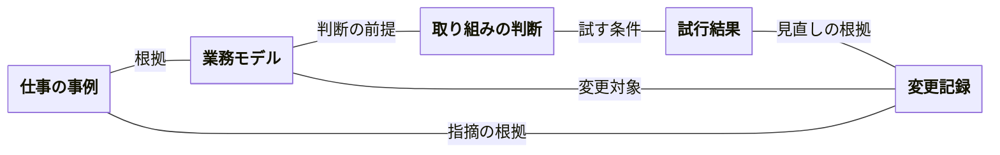

<a name="theme"></a>

# maakbo fde

```mermaid
---
config:
  layout: dagre
  theme: neutral
  flowchart:
    curve: basis
    diagramPadding: 24
    htmlLabels: false
    wrappingWidth: 280
    nodeSpacing: 38
    rankSpacing: 58
    padding: 18
  themeVariables:
    background: "#FFFFFF"
    lineColor: "#8A847A"
    fontFamily: "Inter, Hiragino Sans, sans-serif"
    fontSize: "14px"
  themeCSS: ".image-shape p { padding: 0 !important; background-color:#FFFFFF !important; } .image-shape foreignObject { overflow: visible; } .image-shape .labelBkg { background-color:#FFFFFF !important; } .image-shape .label rect { fill:#FFFFFF !important; opacity:1 !important; } .image-shape[id*='-flowchart-b_'] .label p { margin-top: -6px !important; } .image-shape g:first-child path { stroke:#FFFFFF !important; stroke-width:6px !important; }"
---
flowchart LR
  %% テーマコンテキスト図：製品を育てる活動。fdeで描く個々の仕事は別のテーマ。
  %% 右の仕事関係者は一つのアクター群。複数人を表すが、人数や内訳は特定しない。
  %% 点線は目指すゴールを添えるための注釈。業務フローではない。
  a_product_owner@{ label: "fdeエンジニア", img: "https://raw.githubusercontent.com/maakbo/fde/main/assets/icons/maakbo/user.svg", pos: "b", w: 28, h: 28, constraint: "on" }
  a_build_agent@{ label: "fde AI", img: "https://raw.githubusercontent.com/maakbo/fde/main/assets/icons/maakbo/bot.svg", pos: "b", w: 28, h: 28, constraint: "on" }
  b_fde_product("fdeを育てる")
  a_work_members@{ label: "仕事関係者", img: "https://raw.githubusercontent.com/maakbo/fde/523072a59582f5d41d998c1b2f65929afc47270d/experiments/fde-product-pivot/work-group.svg", pos: "b", w: 28, h: 28, constraint: "on" }
  x_github@{ label: "GitHub", img: "https://raw.githubusercontent.com/maakbo/fde/main/assets/icons/maakbo/server.svg", pos: "b", w: 28, h: 28, constraint: "on" }
  goal["仕事をAIと一緒に可視化して、<br/>関わるものたちが納得して進められて、<br/>仕事がうまくいきます。"]

  a_product_owner --- b_fde_product
  a_build_agent --- b_fde_product
  b_fde_product -.- goal
  b_fde_product --- a_work_members
  b_fde_product --- x_github

  classDef icon fill:none,stroke:none,color:#25231F;
  classDef compass fill:none,stroke:none,color:#25231F,font-weight:600;
  classDef themeNode fill:#FFFFFF,stroke:#4A4640,stroke-width:1.25px,color:#25231F,font-weight:700,font-size:23px;
  class a_product_owner,a_build_agent,a_work_members,x_github icon;
  class goal compass;
  class b_fde_product themeNode;
  linkStyle default stroke:#9E988E,stroke-width:0.75px;
  linkStyle 2 stroke:#A0988E,stroke-width:1px,stroke-dasharray:2 4;
  click a_product_owner href "https://github.com/maakbo/fde/blob/draft/fde-product-pivot/experiments/fde-product-pivot/visualization/README.md#actor-product-owner" "関連する説明を開く" _blank
  click a_build_agent href "https://github.com/maakbo/fde/blob/draft/fde-product-pivot/experiments/fde-product-pivot/visualization/README.md#actor-build-agent" "関連する説明を開く" _blank
  click a_work_members href "https://github.com/maakbo/fde/blob/draft/fde-product-pivot/experiments/fde-product-pivot/visualization/README.md#actor-work-members" "関連する説明を開く" _blank
  click x_github href "https://github.com/maakbo/fde/blob/draft/fde-product-pivot/experiments/fde-product-pivot/visualization/README.md#github" "関連する説明を開く" _blank
```

**仕事をAIと一緒に可視化して、関わるものたちが納得して進められて、仕事がうまくいきます。**

仕事の説明が噛み合わないとき、普段の言葉で一件を持ち寄るところから始めます。fde AIと一緒に、目的・役割・情報のつながりを図にし、実際の仕事と照らして直します。今の進め方を続けるか、何か試すかを決めるのは、仕事に関わる人たちです。ここでは、そのやり方をfde自身を育てる仕事に使っています。

[ fdeエンジニア](#actor-product-owner) · [ fde AI](#actor-build-agent) · [ 仕事関係者](#actor-work-members) · [ GitHub](#github)

### 関わる人と仕組み

| 誰が | どう関わるか |
| --- | --- |
| <a name="actor-product-owner"></a>fdeエンジニア | fdeの設計を整え、使って分かったことを次の設計に生かす。自分で試すときは仕事関係者にもなる。 |
| <a name="actor-build-agent"></a>fde AI | 話し言葉を図や記録にし、ズレの指摘から、ほかに確かめる場所を探す。判断は人に返す。 |
| <a name="actor-work-members"></a>仕事関係者 | 仕事を進める人、判断や支援をする人、成果を受け取る人。立場ごとに見えていることを持ち寄る。 |
| <a name="github"></a>GitHub | 図、用語、判断の記録を共有し、何をなぜ直したかを後からたどれる場所。 |

## 業務

<a name="scope-decide"></a>

### 仕事を持ち寄り、進め方を決める

```mermaid
---
config:
  layout: dagre
  theme: neutral
  flowchart:
    curve: basis
    diagramPadding: 24
    htmlLabels: false
    wrappingWidth: 280
    nodeSpacing: 38
    rankSpacing: 58
    padding: 18
  themeVariables:
    background: "#FFFFFF"
    lineColor: "#8A847A"
    fontFamily: "Inter, Hiragino Sans, sans-serif"
    fontSize: "14px"
  themeCSS: ".image-shape p { padding: 0 !important; background-color:#FFFFFF !important; } .image-shape foreignObject { overflow: visible; } .image-shape .labelBkg { background-color:#FFFFFF !important; } .image-shape .label rect { fill:#FFFFFF !important; opacity:1 !important; } .image-shape[id*='-flowchart-b_'] .label p { margin-top: -6px !important; } .image-shape g:first-child path { stroke:#FFFFFF !important; stroke-width:6px !important; }"
---
flowchart LR
  %% 線は業務に関わる人・情報の関係を示す。手順は各業務のページへ。
  a_work_members@{ label: "仕事関係者", img: "https://raw.githubusercontent.com/maakbo/fde/523072a59582f5d41d998c1b2f65929afc47270d/experiments/fde-product-pivot/work-group.svg", pos: "b", w: 28, h: 28, constraint: "on" }
  a_build_agent@{ label: "fde AI", img: "https://raw.githubusercontent.com/maakbo/fde/main/assets/icons/maakbo/bot.svg", pos: "b", w: 28, h: 28, constraint: "on" }
  a_product_owner@{ label: "fdeエンジニア", img: "https://raw.githubusercontent.com/maakbo/fde/main/assets/icons/maakbo/user.svg", pos: "b", w: 28, h: 28, constraint: "on" }
  b_understand@{ label: "業務を捉える", img: "https://raw.githubusercontent.com/maakbo/fde/main/assets/icons/maakbo/ellipse.svg", pos: "b", w: 28, h: 28, constraint: "on" }
  b_decide@{ label: "取り組みを決める", img: "https://raw.githubusercontent.com/maakbo/fde/main/assets/icons/maakbo/ellipse.svg", pos: "b", w: 28, h: 28, constraint: "on" }
  i_work_example@{ label: "仕事の事例", img: "https://raw.githubusercontent.com/maakbo/fde/main/assets/icons/maakbo/file.svg", pos: "b", w: 28, h: 28, constraint: "on" }
  i_work_model@{ label: "業務モデル", img: "https://raw.githubusercontent.com/maakbo/fde/main/assets/icons/maakbo/file.svg", pos: "b", w: 28, h: 28, constraint: "on" }
  i_direction@{ label: "取り組みの判断", img: "https://raw.githubusercontent.com/maakbo/fde/main/assets/icons/maakbo/file.svg", pos: "b", w: 28, h: 28, constraint: "on" }
  a_work_members --- b_understand
  a_work_members --- b_decide
  a_build_agent --- b_understand
  a_build_agent --- b_decide
  a_product_owner --- b_understand
  a_product_owner --- b_decide
  i_work_example --- b_understand
  b_understand --- i_work_model
  i_work_model --- b_decide
  b_decide --- i_direction
  classDef element fill:none,stroke:none,color:#25231F;
  class a_work_members,a_build_agent,a_product_owner,b_understand,b_decide,i_work_example,i_work_model,i_direction element;
  linkStyle default stroke:#9E988E,stroke-width:0.75px;
  click a_work_members href "https://github.com/maakbo/fde/blob/draft/fde-product-pivot/experiments/fde-product-pivot/visualization/README.md#actor-work-members" "関連する説明を開く" _blank
  click a_build_agent href "https://github.com/maakbo/fde/blob/draft/fde-product-pivot/experiments/fde-product-pivot/visualization/README.md#actor-build-agent" "関連する説明を開く" _blank
  click a_product_owner href "https://github.com/maakbo/fde/blob/draft/fde-product-pivot/experiments/fde-product-pivot/visualization/README.md#actor-product-owner" "関連する説明を開く" _blank
  click b_understand href "https://github.com/maakbo/fde/blob/draft/fde-product-pivot/experiments/fde-product-pivot/visualization/work/understand/README.md" "関連する説明を開く" _blank
  click b_decide href "https://github.com/maakbo/fde/blob/draft/fde-product-pivot/experiments/fde-product-pivot/visualization/work/decide/README.md" "関連する説明を開く" _blank
  click i_work_example href "https://github.com/maakbo/fde/blob/draft/fde-product-pivot/experiments/fde-product-pivot/visualization/README.md#info-work-example" "関連する説明を開く" _blank
  click i_work_model href "https://github.com/maakbo/fde/blob/draft/fde-product-pivot/experiments/fde-product-pivot/visualization/README.md#info-work-model" "関連する説明を開く" _blank
  click i_direction href "https://github.com/maakbo/fde/blob/draft/fde-product-pivot/experiments/fde-product-pivot/visualization/README.md#info-direction" "関連する説明を開く" _blank
```

一件の仕事を、関係者が照らし合わせられる図にします。今のまま続ける、改善を試す、見送るのどれでも、決めた理由を残します。

[ 仕事関係者](#actor-work-members) · [ fde AI](#actor-build-agent) · [ fdeエンジニア](#actor-product-owner) · [ 業務を捉える](work/understand/README.md) · [ 取り組みを決める](work/decide/README.md) · [ 仕事の事例](#info-work-example) · [ 業務モデル](#info-work-model) · [ 取り組みの判断](#info-direction)

<a name="try-revise"></a>

### 試した結果や日々の気づきから見直す

```mermaid
---
config:
  layout: dagre
  theme: neutral
  flowchart:
    curve: basis
    diagramPadding: 24
    htmlLabels: false
    wrappingWidth: 280
    nodeSpacing: 38
    rankSpacing: 58
    padding: 18
  themeVariables:
    background: "#FFFFFF"
    lineColor: "#8A847A"
    fontFamily: "Inter, Hiragino Sans, sans-serif"
    fontSize: "14px"
  themeCSS: ".image-shape p { padding: 0 !important; background-color:#FFFFFF !important; } .image-shape foreignObject { overflow: visible; } .image-shape .labelBkg { background-color:#FFFFFF !important; } .image-shape .label rect { fill:#FFFFFF !important; opacity:1 !important; } .image-shape[id*='-flowchart-b_'] .label p { margin-top: -6px !important; } .image-shape g:first-child path { stroke:#FFFFFF !important; stroke-width:6px !important; }"
---
flowchart LR
  %% 線は業務に関わる人・情報の関係を示す。手順は各業務のページへ。
  a_work_members@{ label: "仕事関係者", img: "https://raw.githubusercontent.com/maakbo/fde/523072a59582f5d41d998c1b2f65929afc47270d/experiments/fde-product-pivot/work-group.svg", pos: "b", w: 28, h: 28, constraint: "on" }
  a_build_agent@{ label: "fde AI", img: "https://raw.githubusercontent.com/maakbo/fde/main/assets/icons/maakbo/bot.svg", pos: "b", w: 28, h: 28, constraint: "on" }
  a_product_owner@{ label: "fdeエンジニア", img: "https://raw.githubusercontent.com/maakbo/fde/main/assets/icons/maakbo/user.svg", pos: "b", w: 28, h: 28, constraint: "on" }
  x_github@{ label: "GitHub", img: "https://raw.githubusercontent.com/maakbo/fde/main/assets/icons/maakbo/server.svg", pos: "b", w: 28, h: 28, constraint: "on" }
  b_validate@{ label: "改善を試して確かめる", img: "https://raw.githubusercontent.com/maakbo/fde/main/assets/icons/maakbo/ellipse.svg", pos: "b", w: 28, h: 28, constraint: "on" }
  b_maintain@{ label: "仕事とモデルを見直す", img: "https://raw.githubusercontent.com/maakbo/fde/main/assets/icons/maakbo/ellipse.svg", pos: "b", w: 28, h: 28, constraint: "on" }
  i_direction@{ label: "取り組みの判断", img: "https://raw.githubusercontent.com/maakbo/fde/main/assets/icons/maakbo/file.svg", pos: "b", w: 28, h: 28, constraint: "on" }
  i_trial@{ label: "試行結果", img: "https://raw.githubusercontent.com/maakbo/fde/main/assets/icons/maakbo/file.svg", pos: "b", w: 28, h: 28, constraint: "on" }
  i_work_example@{ label: "仕事の事例", img: "https://raw.githubusercontent.com/maakbo/fde/main/assets/icons/maakbo/file.svg", pos: "b", w: 28, h: 28, constraint: "on" }
  i_work_model@{ label: "業務モデル", img: "https://raw.githubusercontent.com/maakbo/fde/main/assets/icons/maakbo/file.svg", pos: "b", w: 28, h: 28, constraint: "on" }
  i_change@{ label: "変更記録", img: "https://raw.githubusercontent.com/maakbo/fde/main/assets/icons/maakbo/file.svg", pos: "b", w: 28, h: 28, constraint: "on" }
  a_work_members --- b_validate
  a_work_members --- b_maintain
  a_build_agent --- b_validate
  a_build_agent --- b_maintain
  a_product_owner --- b_validate
  a_product_owner --- b_maintain
  i_direction --- b_validate
  b_validate --- i_trial
  i_trial --- b_maintain
  i_work_example --- b_maintain
  b_maintain --- i_work_model
  b_maintain --- i_change
  b_maintain --- x_github
  classDef element fill:none,stroke:none,color:#25231F;
  class a_work_members,a_build_agent,a_product_owner,x_github,b_validate,b_maintain,i_direction,i_trial,i_work_example,i_work_model,i_change element;
  linkStyle default stroke:#9E988E,stroke-width:0.75px;
  click a_work_members href "https://github.com/maakbo/fde/blob/draft/fde-product-pivot/experiments/fde-product-pivot/visualization/README.md#actor-work-members" "関連する説明を開く" _blank
  click a_build_agent href "https://github.com/maakbo/fde/blob/draft/fde-product-pivot/experiments/fde-product-pivot/visualization/README.md#actor-build-agent" "関連する説明を開く" _blank
  click a_product_owner href "https://github.com/maakbo/fde/blob/draft/fde-product-pivot/experiments/fde-product-pivot/visualization/README.md#actor-product-owner" "関連する説明を開く" _blank
  click x_github href "https://github.com/maakbo/fde/blob/draft/fde-product-pivot/experiments/fde-product-pivot/visualization/README.md#github" "関連する説明を開く" _blank
  click b_validate href "https://github.com/maakbo/fde/blob/draft/fde-product-pivot/experiments/fde-product-pivot/visualization/work/validate/README.md" "関連する説明を開く" _blank
  click b_maintain href "https://github.com/maakbo/fde/blob/draft/fde-product-pivot/experiments/fde-product-pivot/visualization/work/maintain/README.md" "関連する説明を開く" _blank
  click i_direction href "https://github.com/maakbo/fde/blob/draft/fde-product-pivot/experiments/fde-product-pivot/visualization/README.md#info-direction" "関連する説明を開く" _blank
  click i_trial href "https://github.com/maakbo/fde/blob/draft/fde-product-pivot/experiments/fde-product-pivot/visualization/README.md#info-trial" "関連する説明を開く" _blank
  click i_work_example href "https://github.com/maakbo/fde/blob/draft/fde-product-pivot/experiments/fde-product-pivot/visualization/README.md#info-work-example" "関連する説明を開く" _blank
  click i_work_model href "https://github.com/maakbo/fde/blob/draft/fde-product-pivot/experiments/fde-product-pivot/visualization/README.md#info-work-model" "関連する説明を開く" _blank
  click i_change href "https://github.com/maakbo/fde/blob/draft/fde-product-pivot/experiments/fde-product-pivot/visualization/README.md#info-change" "関連する説明を開く" _blank
```

試すと決めた場合は結果を持ち寄ります。改善を試していなくても、仕事と図が違うという指摘だけで見直せます。手順は変えず、図だけを直しても構いません。

[ 仕事関係者](#actor-work-members) · [ fde AI](#actor-build-agent) · [ fdeエンジニア](#actor-product-owner) · [ GitHub](#github) · [ 改善を試して確かめる](work/validate/README.md) · [ 仕事とモデルを見直す](work/maintain/README.md) · [ 取り組みの判断](#info-direction) · [ 試行結果](#info-trial) · [ 仕事の事例](#info-work-example) · [ 業務モデル](#info-work-model) · [ 変更記録](#info-change)

<a name="information"></a>

## 情報



| この仕事で使う言葉 | 意味 | どこで使うか |
| --- | --- | --- |
| <a name="info-work-example"></a> 仕事の事例 | 実際に起きた一件。誰が何を受け取り、どう判断して誰に渡したかをたどれる話や記録。 | [業務を捉える](work/understand/README.md)・[仕事とモデルを見直す](work/maintain/README.md) |
| <a name="info-work-model"></a> 業務モデル | 仕事の目的・関係者・業務・情報のつながりを、関係者の言葉で表したもの。 | [業務を捉える](work/understand/README.md)・[取り組みを決める](work/decide/README.md)・[仕事とモデルを見直す](work/maintain/README.md) |
| <a name="info-direction"></a> 取り組みの判断 | 今のやり方を続ける、改善を試す、見送るなど、次の方針と理由。試すときは確かめ方も含む。 | [取り組みを決める](work/decide/README.md)・[改善を試して確かめる](work/validate/README.md) |
| <a name="info-trial"></a> 試行結果 | 事前に合意した条件で試し、分かった変化と、まだ測れていないことを残したもの。 | [改善を試して確かめる](work/validate/README.md)・[仕事とモデルを見直す](work/maintain/README.md) |
| <a name="info-change"></a> 変更記録 | 何を直すか、何を変えないか、その理由と影響範囲の記録。 | [仕事とモデルを見直す](work/maintain/README.md) |

## 関連リンク

- <a name="uc-understand"></a>[業務を捉える](work/understand/README.md)：説明が噛み合わず、実際の仕事を一緒に確かめたいとき。
- <a name="uc-decide"></a>[取り組みを決める](work/decide/README.md)：そのまま進めるか、別のやり方を試すか考えたいとき。
- <a name="uc-validate"></a>[改善を試して確かめる](work/validate/README.md)：決めた条件で試して、どんな変化があったか確かめたいとき。
- <a name="uc-maintain"></a>[仕事とモデルを見直す](work/maintain/README.md)：日々の指摘や試した結果から、図や手順を見直したいとき。
- [FDEの実務ガイド](../../../work/README.md)：業務理解から導入・運用までの進め方。
