# Mermaid標準記法と、今のfdeを比べる

2026-10-13 / 比較試作・採用未決定。現行図と既存のVisual languageは変更していない。

まず **[人と業務の図](#1-fdeを誰と実現するか)** と **[担当別のフロー](#5-要件合意)** を見比べる。標準記法の見た目が好みに合うか、担当と引き渡しが読みやすくなるかを確かめたい。

PNGはMarkdown内のMermaidから直接描画した固定の比較用プレビュー。画像を開くと拡大できる。新記法がGitHubで描画されなくても、このページの画像で比較できる。SVGも同じ名前で `previews/` に置いている。画像の位置・文字をexport後に調整していない。

## 1. FDEを誰と実現するか

[現行source](../../examples/maakbo-fde/system-context.md) · [ユースケースsourceと省略](fde-participants-usecase.md)

| 現行の固定アイコン | 標準アクター・楕円（neutral / classic） |
| --- | --- |
| 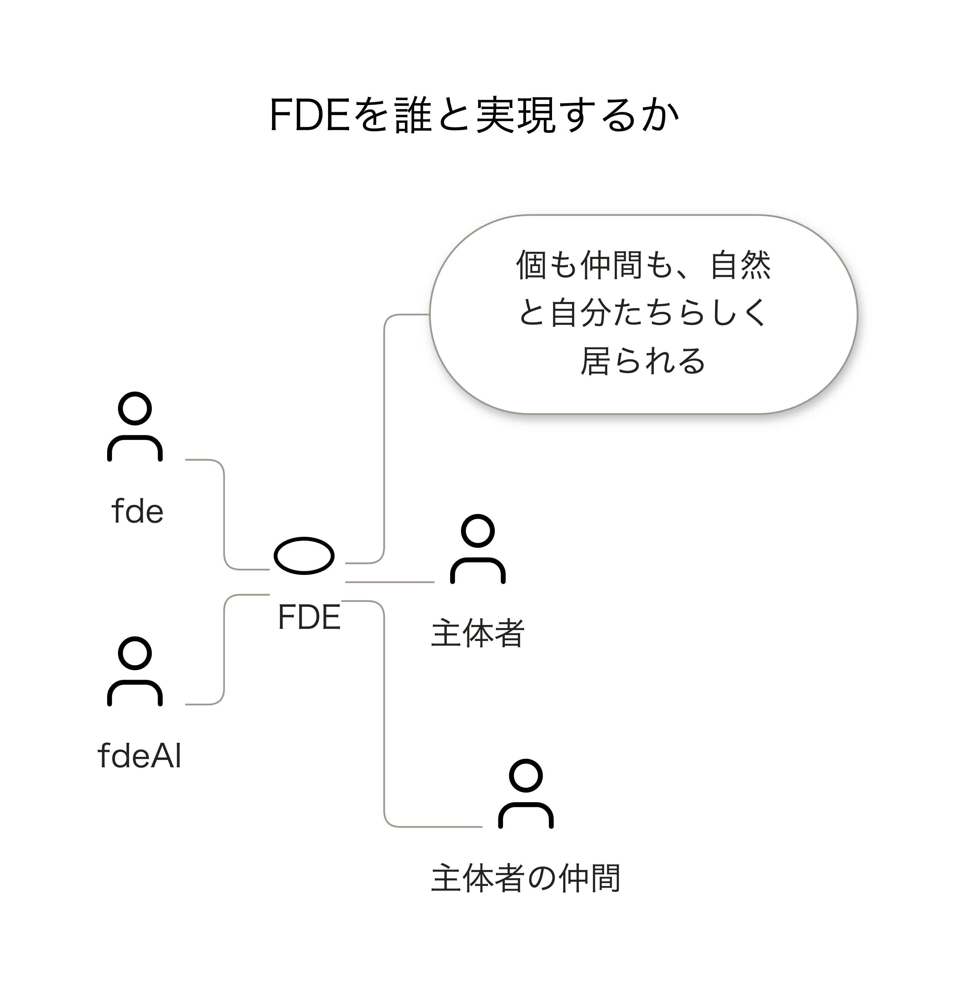 | 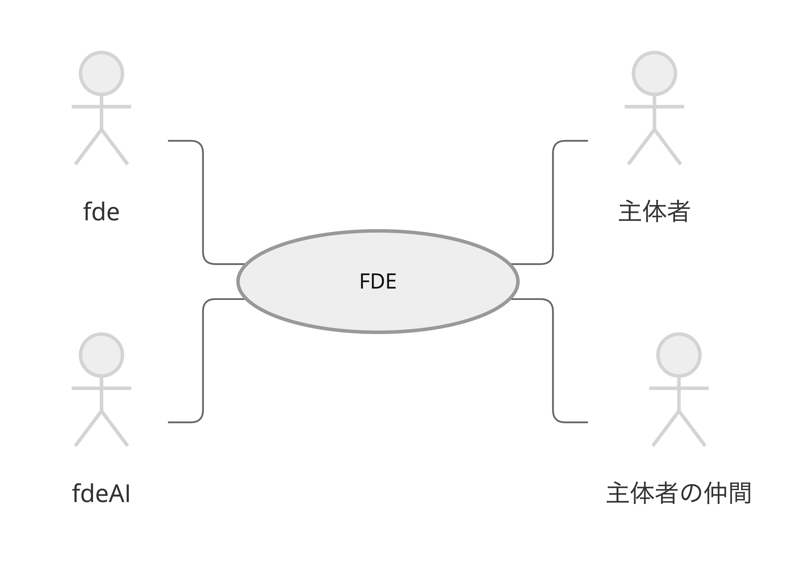 |

Actor 4件、Business 1件、参加関係4本を保持した。現行の目的「個も仲間も、自然と自分たちらしく居られる」と、その目的への線は図から外して本文へ移した。

標準の棒人間は識別しやすい。楕円は大きく、文字を内側に置くため、今の小さな楕円・下ラベルとは違う印象になる。目的を省いた分の簡潔さも含むので、完全な同等比較ではない。

### Mermaid既定の外観

[既定のsource](fde-participants-default.md)。上の標準記法とノード・関係・方向は同じ。theme / look / layoutの明示設定を外した外観比較である。

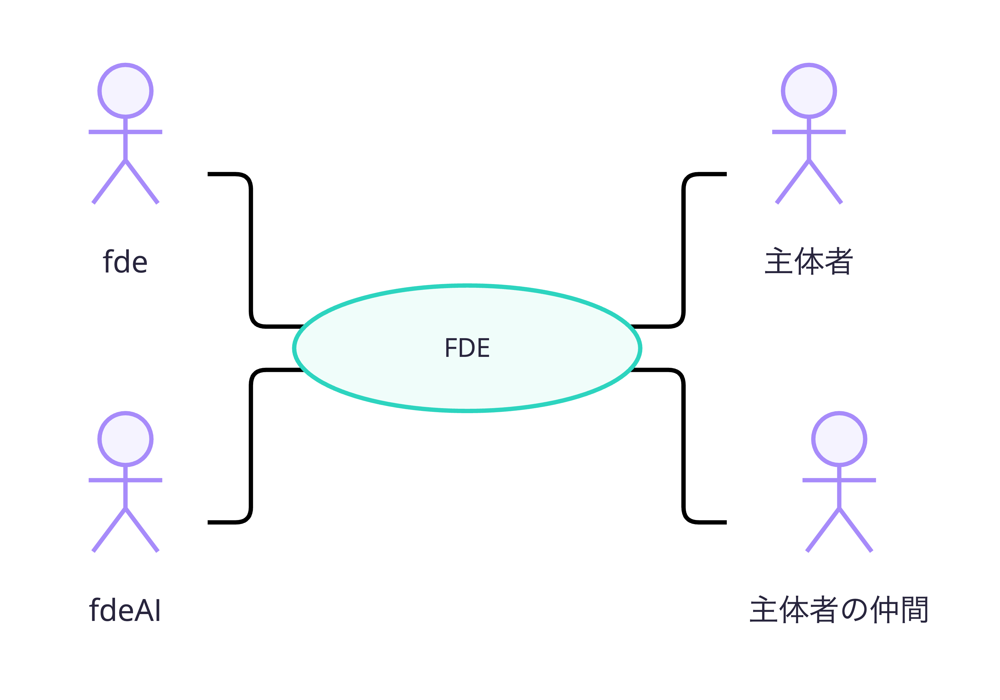

## 2. 業務の変化を描く

[現行source](../../examples/maakbo-fde/shape-change-context.md) · [ユースケースsourceと省略](fde-change-usecase.md)

| 現行のBusiness Context | アクターと業務へ絞ったユースケース |
| --- | --- |
| 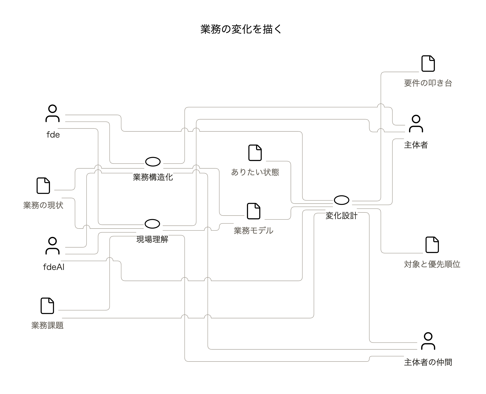 | 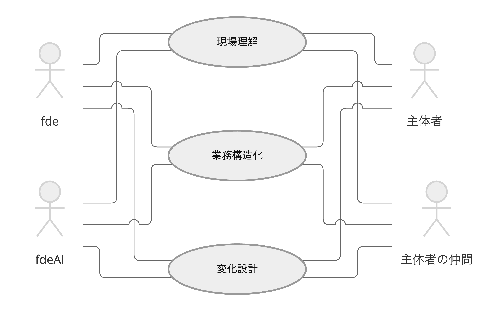 |

Actor 4件、Business 3件、参加関係12本を保持。情報6件と関連10本を省略した。情報の受け渡しが見えなくなるため、業務Contextの全面置換ではなく、**「誰がどの業務に関わるか」を見る別View**として評価する。

## 3. 要求を整える

[現行source](../../examples/system-development/requirements/README.md) · [ユースケースsourceと省略](requirements-usecase.md)

| 現行のBusiness Context | アクターと業務へ絞ったユースケース |
| --- | --- |
| 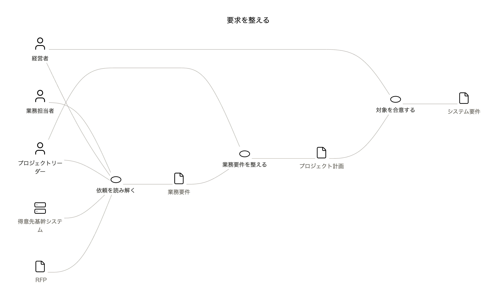 | 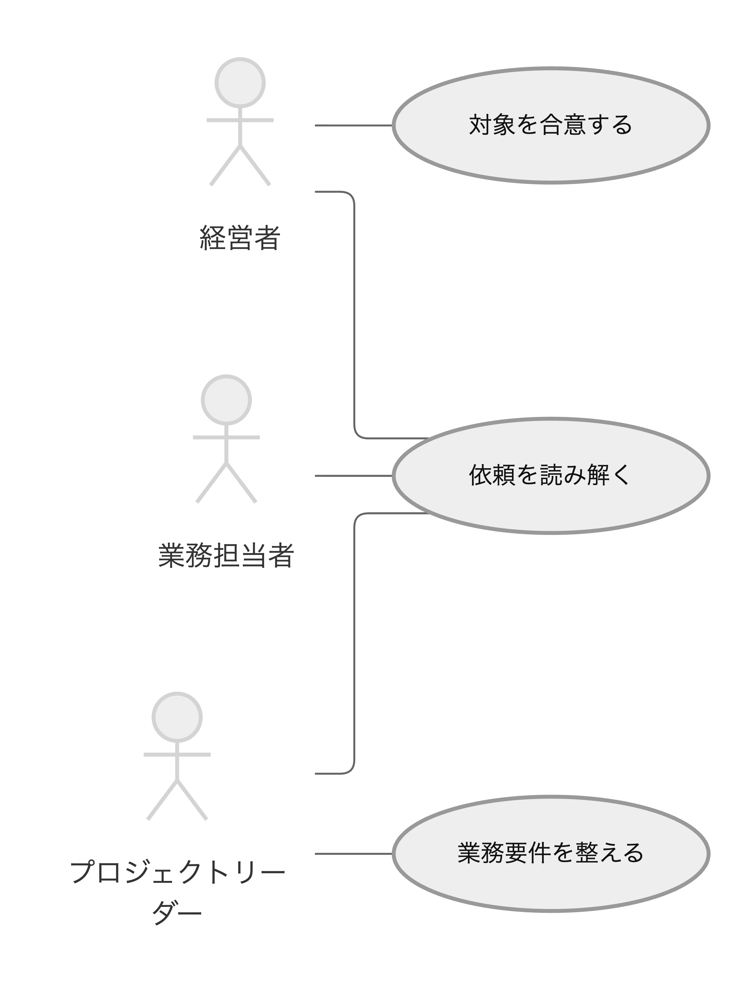 |

Actor 3件、Business 3件、参加関係5本を保持。情報4件・外部システム1件と関連7本を省略した。元図の詳細Flowへのnode clickは比較図へ移さず、本文リンクで参照する。情報を省くと元の業務のつながりも見えなくなる。

外部システムを棒人間へ分類変更することや、情報をユースケースへ読み替えることはしていない。Mermaid自体に拡張方法があっても、標準のactorと楕円だけで現行Context全体を置換できたとは判定しない。

## 4. 対象を見極め、業務を定義する

[現行source](../../examples/maakbo-fde/change-design-flow.md) · [スイムレーンsourceと担当案](fde-change-swimlane.md)

| 現行のFlow | 四者の共同レーン（仮置き） |
| --- | --- |
| 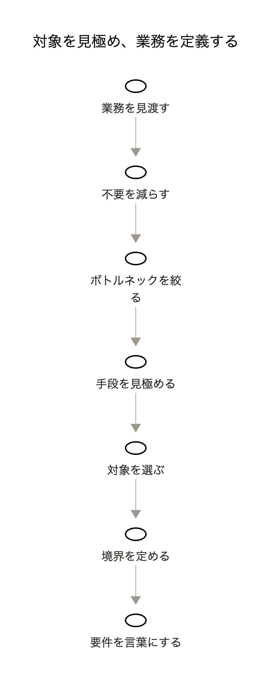 | 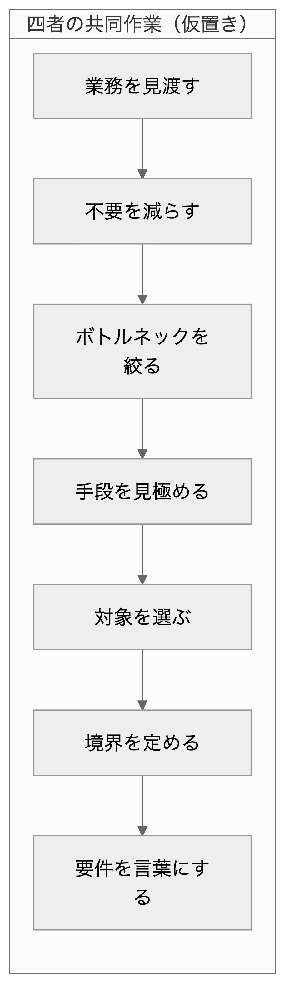 |

最新mainの7工程・6本の矢印を保持した。計画時の古い3工程には戻していない。担当ごとの責任は未確定なので、四者の共同作業という仮置きに留めた。1レーンでは引き渡しの利点を評価できず、この題材では現行Flowの方が軽い可能性がある。

## 5. 要件合意

[現行source](../../examples/system-development/requirements/alignment-flow.md) · [スイムレーンsourceと担当案](requirements-swimlane.md)

| 現行のFlow | 担当別レーン（仮置き） |
| --- | --- |
| 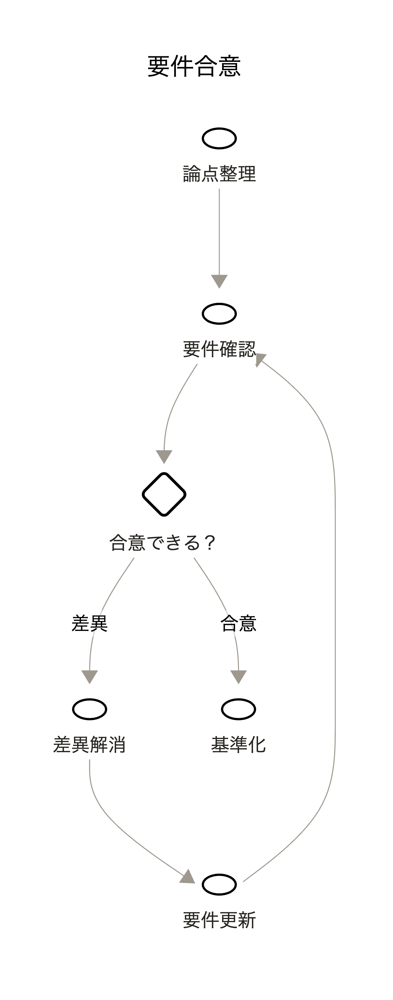 | 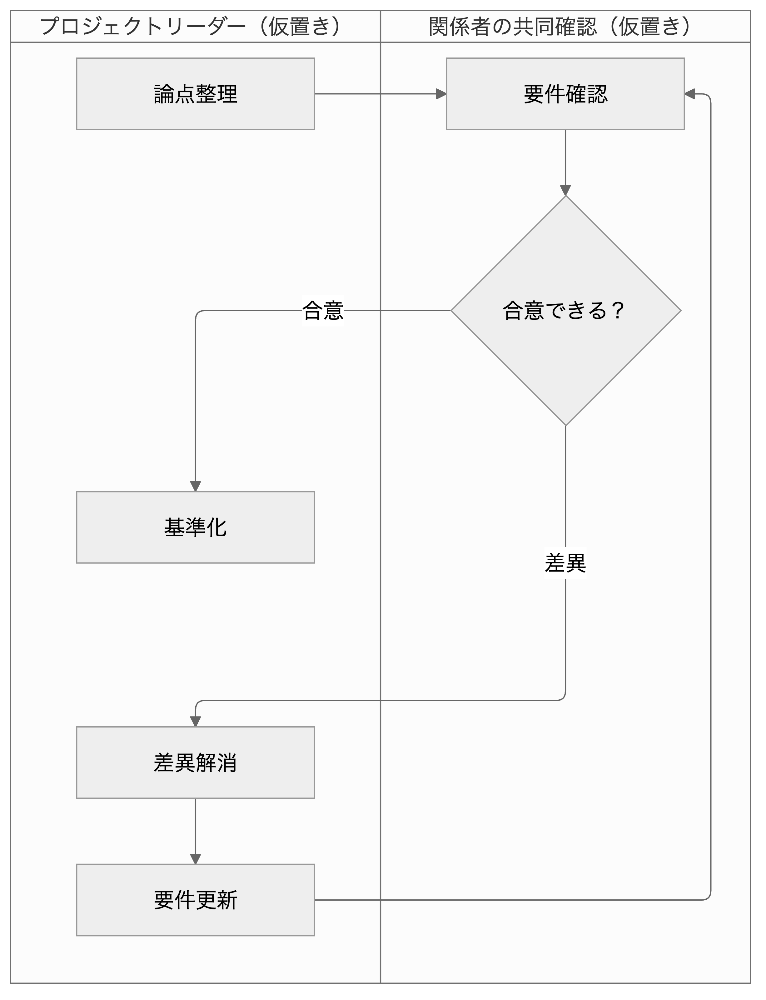 |

6ノード・6本の矢印、合意／差異の条件と戻りを保持した。論点整理・差異解消・要件更新・基準化はプロジェクトリーダー、要件確認・合意判断は関係者の共同レーンへ仮置き。責任分担の確定ではない。

## 現在の判断

| 選択肢 | 意味 | 現時点の推奨 |
| --- | --- | --- |
| 置換 | 現行の図を新記法へ移す | 保留。情報・目的・外部システムの表現と閲覧環境への適合が必要 |
| 併用 | Actor × Businessはユースケース、担当を見たいFlowはスイムレーン | 第一候補。元のContextが担う情報の関係を保てる |
| 現状維持 | 固定アイコンと下ラベルを継続する | 小さく静かな見た目や単純な順序を優先する場面に適する |

本人の好みは未確認。まず「1の標準アクターと楕円」「5の担当レーン」が、今の図より好みに近いかを見る。採用を決めるまでは正本やSkillの規約を更新しない。

## 検証と再現

基準source: `eb88c959cade222fa6499e6252c75e73a6650220`。Nodeとnpmで比較専用のruntimeを用意する。既存repoのpackage.json / lockは変更していない。

```sh
runtime_dir="$(mktemp -d)"
npm install --prefix "$runtime_dir" --save-exact @mermaid-js/mermaid-cli@12.0.0 mermaid@12.1.0
python3 experiments/mermaid-native-2026-10-13/check.py
python3 experiments/mermaid-native-2026-10-13/render.py --mmdc "$runtime_dir/node_modules/.bin/mmdc"
python3 scripts/validate_repository.py
```

Node >=22.13.0。ChromeまたはPuppeteerのbrowserが必要。MacのChromeが存在すればrender scriptが利用する。別環境では `PUPPETEER_EXECUTABLE_PATH` を指定できる。npmがPuppeteerのinstall scriptを保留する環境では、既存のChromeを利用する。

ユースケースだけlayoutをELKへ明示する。スイムレーンは専用の標準layoutを使い、top-level `layout: elk` を指定しない。指定すると担当レーンではなく通常のcluster配置になることを試作中に確認した。

- 意味保持: `check.py` PASS。参加関係4／12／5本、全省略1／10／7本、両Flowの全ノード・矢印、既定外観とneutral版の同じgraphを照合。
- 描画: Mermaid 12.1.0 / CLI 12.0.0で、試作6件＋現行5件のSVG / PNGを生成できた。現行プレビューも同じruntimeで再描画しているため、旧runtimeの画像そのものとの比較ではない。
- repo全体validator: FAIL。変更前のcleanな基準sourceでも同じ失敗を再現。`build-collaboration-context.md` が14ノード・21関係の複雑度警告で停止（意味エラー0件、警告2件）。既存のモデル・validatorは今回変更していない。
- Obsidianプレビュー: 本人の指定により対象外。

公式: [ユースケース図（12.0.0+）](https://mermaid.js.org/syntax/usecase.html) · [スイムレーン図（11.16.0+）](https://mermaid.js.org/syntax/swimlanes)。新記法の対応バージョンと、GitHubで実表示できることは別に確認する。

### 目視結果

- 11件のPNGを確認。日本語の欠けは見られない。長いラベルには自動折り返しがあり、FDE Flowの末尾「要件を言葉にする」が最後の1文字で折り返される点は残る。
- ユースケースのneutralテーマは棒人間が薄いグレーで、既定外観は色と線が強い。標準の関連線は棒人間の図形から少し離れて見える。独自CSSで補正せず、標準記法の性質として比較する。
- 3業務へ四者が参加する図には複数の交差が残る。交点の曲線で線を区別できるが、標準記法にすれば必ず交差が減るわけではない。
- 要件合意の担当レーンは左右に並び、横断する矢印で引き渡しを追える。長い戻り線は目立つが、合意／差異の分岐と再確認の方向は読める。
- 単一共同レーンのFDE Flowは縦長。担当間の引き渡しを示す利点はこの題材では得られない。
- 独立review（Sol High）: 元図との意味対応と担当の仮置きに重大な不一致なし。上記の折り返しと長い戻り線は比較時の観察点として保持する。

### GitHub実表示

2026-10-13、public mainの `260c692` をブラウザーで確認した。

- ユースケース4件（neutral 3件＋既定1件）、スイムレーン2件の全sourceページで、Mermaidのdiagramと各ラベルの実表示を確認。parse errorは表示されなかった。GitHub側の正確なMermaid versionは取得していない。
- 768 × 1024pxのブラウザーviewportで比較ページを確認。ページのscrollWidthは768pxで横にはみ出さず、11枚の画像が読み込まれた。「FDEを誰と実現するか」と「要件合意」の比較を目視した。
- 2列比較では画像の文字が小さくなる。要件合意は、現行画像が約219px幅、担当レーンが約396px幅で表示された。図の構成は比較できるが、細部の確認は画像を開いて拡大する前提。実物のiPad上では未検証。
- 現行と新記法では図の縦横比が違い、Markdown tableの列幅も同じにならない。同じruntimeとページ幅での比較であり、図形や文字を同じ物理サイズへ補正した比較ではない。

成果は比較ディレクトリ内だけ。元のexamples、Skill、既存runtimeの設定は変更していない。次の判断は、この見た目で併用したいか、静かな固定アイコンを優先したいかの本人レビュー。

公開時の初回pushはHTTP 400 / RPC failedで失敗し、remote mainが基準commitのままであることを確認した。コマンド単位のHTTP/1.1・送信buffer指定で再試行して成功し、remote mainのcommit一致を確認した。恒久的なGit設定変更は行っていない。

この比較で保存した旧Lucide由来の埋込SVGには、[履歴素材の第三者ライセンス表示](THIRD_PARTY_NOTICES.md)が付属します。現行のmaakbo／MDIセットとは別の比較履歴です。
